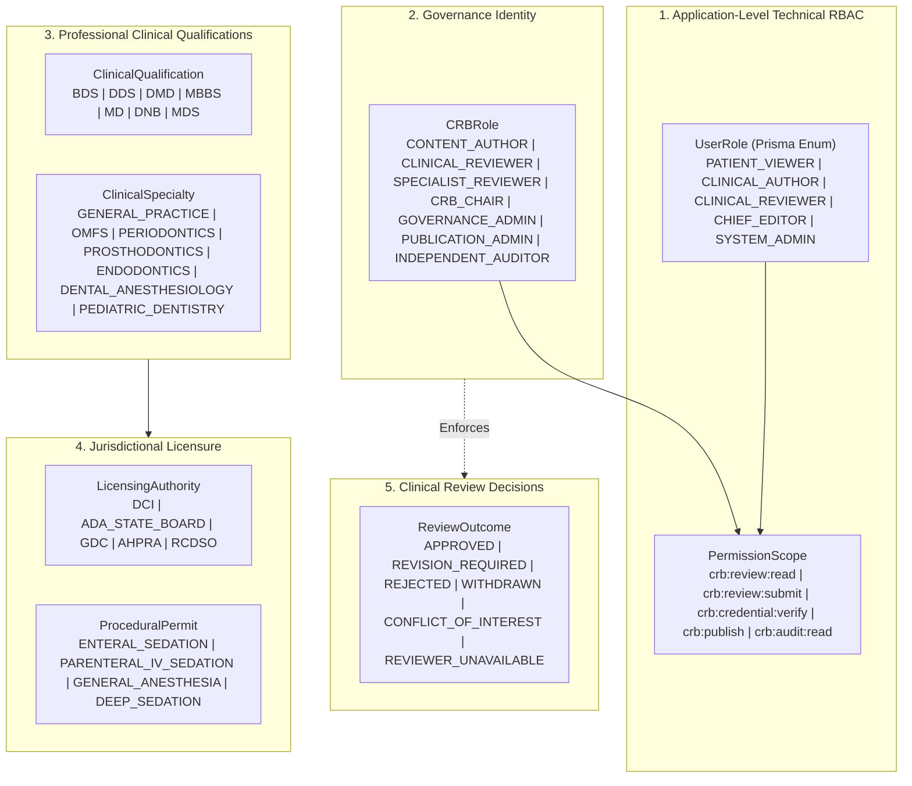
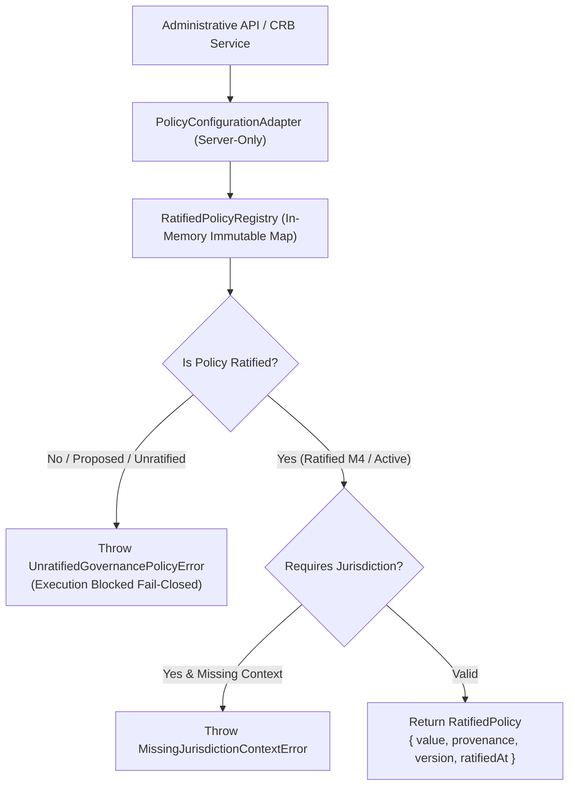

# DentalVis — Phase M6.1.2: Governance Core Types & Fail-Closed Policy Adapter
## Implementation Planning & Technical Architecture Specification

**Architecture Baseline:** v1.9.1 — FROZEN  
**Target Milestone:** M6.1.2 (Second Implementation Sub-Milestone of M6.1)  
**Parent Blueprint:** `docs/architecture/M6_1_GOVERNANCE_SERVICE_LAYER_IMPLEMENTATION_PLAN.md`  
**Foundational Database Milestone:** M6.1.1 (Audit Log Immutability Migration — Verified Commit `e9cb956`)  
**Status:** Planning & Architectural Specification Only (Read-Only Planning)  
**Effective Date:** November 24, 2026  
**Target Packages:** `packages/common` (Shared Governance DTOs & Domain Enums), `packages/database` (Server-Only Policy Engine & Type Guards)  

---

## 1. Executive Summary

Phase M6.1.2 establishes the shared, strongly typed domain model and the server-only, fail-closed policy configuration adapter required by all downstream Clinical Review Board (CRB) services.

### Core Objectives & Deliverables
1. **Strongly Typed Governance Domain Model:** Formalize type definitions for governance roles, permission scopes, clinical review lifecycle states, review outcomes, procedure risk tiers, reviewer eligibility, credential verification states, conflict-of-interest (COI) declarations, policy ratification registers, approval evidence, and audit event classifications.
2. **Clear Separation of Concerns:** Strictly distinguish between technical authorization roles (`UserRole`), governance operational identities (`CRBRole`), professional clinical qualifications (BDS/DDS/DMD, Statutory Specialties), jurisdiction-specific licensing recognition, and individual clinical review decisions.
3. **Fail-Closed Policy Adapter:** Design a server-only policy evaluation engine that loads only explicitly ratified governance policies, rigorously rejects unratified or proposed policies without synthetic defaults, preserves policy provenance and versioning, and provides deterministic, testable evaluation.
4. **Preservation of Existing Invariants:** Maintain the frozen v1.9.1 architecture baseline, protect M6.1.1 database audit log immutability, preserve all previously ratified M4 policies, keep `DENTALVIS_PROCEDURE_PROVIDER=static` as default, and strictly prevent AI clinical sign-off or automated clinical approvals.

> [!IMPORTANT]
> **Planning and Design Only:** This document is an implementation plan and architectural specification. No application source code, shared types, Prisma schemas, database migrations, policy configurations, or reviewer accounts are created or altered during this planning phase.

---

## 2. Existing Architecture Audit & Repository Findings

A comprehensive audit of the repository, existing packages, schemas, and governance specifications established the following technical baseline:

### 2.1 Package & Module Boundaries
- **`packages/common` (`packages/common/src/index.ts`):** Contains isomorphic types shared between web frontend, admin frontend, and backend services. Currently defines `ContentLanguage` ('en' | 'ta'), `ContentStatus`, `ApprovalDecision` ('APPROVED' | 'REJECTED'), `GovernanceTier` ('TIER_1' | 'TIER_2' | 'TIER_3'), and `ProcedureRevisionSnapshot`.
- **`packages/database` (`packages/database/src/index.ts`):** Exports the generated Prisma Client, repository mappers, seed planners, and domain invariant guards (`domainInvariants.ts`). Target home for server-only governance services (`packages/database/src/governance/*`).
- **`apps/web` (`apps/web/src/server/procedureRepository.ts`):** Enforces the `'server-only'` boundary and exports `getProcedureRepository()`. Target host for future authenticated administrative API routes (`/api/admin/crb/*`).
- **`apps/admin` (`apps/admin/src/App.tsx`):** Standalone Vite + React Single-Page Application (SPA) consuming administrative APIs cross-origin.

### 2.2 Role Model Reconciliation (5 Technical Roles vs 7 Governance Roles)
The application-level enum `UserRole` in `packages/database/prisma/schema.prisma` is frozen at 5 technical values:
1. `PATIENT_VIEWER`
2. `CLINICAL_AUTHOR`
3. `CLINICAL_REVIEWER`
4. `CHIEF_EDITOR`
5. `SYSTEM_ADMIN`

It is essential to maintain clear architectural separation: `UserRole` is an application-level user role represented in the Prisma data model for application RBAC. It must not be conflated with PostgreSQL database user credentials, database connection roles, or database engine privileges (such as `dentalvis_user`).

The M5 Clinical Review Board Workflow defines 7 governance operational roles. As reconciled in M6 and M6.1, the mapping between application-level `UserRole` and governance identities is strictly maintained:

| Governance CRB Role | Technical Role (`UserRole`) | Authorization Guard & Scope Enforcement | Read/Write Scope |
| :--- | :--- | :--- | :--- |
| **Content Author** | `CLINICAL_AUTHOR` | Direct 1:1 role mapping. Author of target revision cannot approve own work (`enforceNoAuthorSelfApproval`). | Authoring & line-item response |
| **Clinical Reviewer** | `CLINICAL_REVIEWER` | Direct 1:1 role mapping. Valid for Tier 1 and Tier 2 content review. | Clinical review & decision |
| **Specialist Reviewer** | `CLINICAL_REVIEWER` | Technical role `CLINICAL_REVIEWER` + verified specialty claim (e.g. `OMFS`, `PERIODONTICS`, `DENTAL_ANESTHESIOLOGY`). Mandatory for Tier 3. | Tier 3 clinical review |
| **CRB Chair (Chief Editor)**| `CHIEF_EDITOR` | Technical role `CHIEF_EDITOR` + active Board Chair assignment. Can manage review assignments and revoke approvals. | Editorial & review oversight |
| **Governance Administrator**| `SYSTEM_ADMIN` | Technical role `SYSTEM_ADMIN` scoped to operational workflows (credential verification, COI audit). Cannot sign off clinical content. | Credential & lifecycle admin |
| **Publication Administrator**| `CHIEF_EDITOR` (or `SYSTEM_ADMIN`)| Technical role with dedicated publication authority scope (`crb:publish`). Cannot approve clinical revisions; requires valid approval quorum. | Publication gating |
| **Independent Auditor** | Isolated Principal | Strictly read-only governance identity. Mapped to a dedicated session authorization principal with zero mutation permissions (`crb:audit:read`). | Audit inspection (Read-Only) |

---

## 3. Governance Type System Design

The governance type system will be introduced into `packages/common/src/governance.ts` (isomorphic DTOs, enums, and read-only interfaces) and re-exported from `packages/common/src/index.ts`. Server-only guards and execution schemas will reside in `packages/database/src/governance/types.ts`.

### 3.1 Taxonomy of Separation: Roles vs Qualifications vs Decisions

To prevent dangerous conflations (such as treating a system administrator as a clinical specialist or treating an administrative permission as a medical degree), the type system strictly isolates five distinct dimensions:



### 3.2 Core Type Definitions

#### 1. Governance Roles & Permission Scopes
```typescript
export type CRBRole =
  | 'CONTENT_AUTHOR'
  | 'CLINICAL_REVIEWER'
  | 'SPECIALIST_REVIEWER'
  | 'CRB_CHAIR'
  | 'GOVERNANCE_ADMIN'
  | 'PUBLICATION_ADMIN'
  | 'INDEPENDENT_AUDITOR';

export type GovernancePermissionScope =
  | 'crb:dossier:read'
  | 'crb:dossier:draft'
  | 'crb:review:assign'
  | 'crb:review:accept'
  | 'crb:review:assess'
  | 'crb:review:submit'
  | 'crb:credential:verify'
  | 'crb:coi:audit'
  | 'crb:publish:authorize'
  | 'crb:approval:revoke'
  | 'crb:policy:read'
  | 'crb:audit:read';
```

#### 2. Clinical Review Lifecycle States & Review Outcomes
```typescript
export type ClinicalReviewLifecycleStage =
  | 'STAGE_01_CONTENT_PREPARED'
  | 'STAGE_02_ELIGIBILITY_VALIDATION'
  | 'STAGE_03_CREDENTIAL_VERIFICATION'
  | 'STAGE_04_REVIEWER_ASSIGNMENT'
  | 'STAGE_05_COI_DECLARATION'
  | 'STAGE_06_INVITATION_ACCEPTANCE'
  | 'STAGE_07_CLINICAL_ASSESSMENT'
  | 'STAGE_08_FEEDBACK_REVISIONS'
  | 'STAGE_09_AUTHOR_RESUBMISSION'
  | 'STAGE_10_FINAL_DECISION'
  | 'STAGE_11_EVIDENCE_RECORDING'
  | 'STAGE_12_PUBLICATION_PREFLIGHT'
  | 'STAGE_13_PUBLICATION_AUTHORIZATION'
  | 'STAGE_14_PERIODIC_REASSESSMENT'
  | 'STAGE_15_APPROVAL_REVOCATION';

export type ReviewOutcome =
  | 'APPROVED'
  | 'REVISION_REQUIRED'
  | 'REJECTED'
  | 'WITHDRAWN'
  | 'CONFLICT_OF_INTEREST'
  | 'REVIEWER_UNAVAILABLE';
```

#### 3. Reviewer Qualifications & Credential Verification States
```typescript
export type StatutorySpecialty =
  | 'ORAL_AND_MAXILLOFACIAL_SURGERY'
  | 'PERIODONTICS'
  | 'ENDODONTICS'
  | 'PROSTHODONTICS'
  | 'ORTHODONTICS'
  | 'PEDIATRIC_DENTISTRY'
  | 'DENTAL_ANESTHESIOLOGY'
  | 'ORAL_MEDICINE_AND_RADIOLOGY'
  | 'GENERAL_DENTISTRY';

export type StatutoryLicensingAuthority =
  | 'DENTAL_COUNCIL_OF_INDIA'
  | 'US_STATE_DENTAL_BOARD'
  | 'UK_GENERAL_DENTAL_COUNCIL'
  | 'AUSTRALIAN_HEALTH_PRACTITIONER_REGULATION_AGENCY'
  | 'ROYAL_COLLEGE_OF_DENTAL_SURGEONS_OF_ONTARIO'
  | 'OTHER_STATUTORY_AUTHORITY';

export type CredentialVerificationStatus =
  | 'UNVERIFIED'
  | 'VERIFIED_ACTIVE'
  | 'EXPIRED'
  | 'REVOKED_OR_SUSPENDED'
  | 'SANCTIONED';

export interface ReviewerCredentialState {
  reviewerUserId: string;
  primaryLicenseNumber: string;
  licensingAuthority: StatutoryLicensingAuthority;
  jurisdictionCountry: string;
  jurisdictionSubdivision?: string; // State / Province
  specialty: StatutorySpecialty;
  verificationStatus: CredentialVerificationStatus;
  verifiedAt: string; // ISO 8601
  expiresAt: string; // ISO 8601
  verifiedByUserId: string;
  proceduralPermits: string[];
}
```

#### 4. Conflict-of-Interest (COI) Declaration
```typescript
export interface ConflictOfInterestDeclaration {
  declarationId: string;
  reviewerUserId: string;
  procedureRevisionId: string;
  hasCommercialRelationship: boolean;
  commercialEntityNames?: string[];
  financialCompensationAmountUsd?: number;
  hasPersonalFinancialStake: boolean;
  agreesToConfidentiality: boolean;
  declaredAt: string; // ISO 8601
  declarationSignatureHash: string; // SHA-256 of canonical declaration payload
}
```

#### 5. Approval Evidence & Publication Preflight
```typescript
export interface ClinicalApprovalEvidence {
  approvalId: string;
  procedureRevisionId: string;
  contentRevisionHash: string; // RFC 8785 canonical JSON hash
  reviewerUserId: string;
  reviewerLicenseNumber: string;
  reviewerSpecialty: StatutorySpecialty;
  decision: 'APPROVED';
  clinicalRationale: string;
  signedAt: string; // ISO 8601
  isRevoked: boolean;
}

export interface PublicationPreflightResult {
  procedureId: string;
  targetRevisionId: string;
  contentHashMatches: boolean;
  englishStatus: ContentStatus;
  tamilStatus: ContentStatus;
  activeApprovalsCount: number;
  quorumSatisfied: boolean;
  specialistRequirementSatisfied: boolean;
  bilingualSignOffSatisfied: boolean;
  mediaVerificationPassed: boolean;
  isEligibleForPublication: boolean;
  rejectionReasons: string[];
}
```

---

## 4. Fail-Closed Policy Adapter Architecture

The policy configuration adapter (`PolicyConfigurationAdapter`) provides centralized, deterministic governance policy evaluations.

### 4.1 Core Invariants of the Adapter

1. **Ratification Gating:** The adapter evaluates only explicitly ratified policies. If an operational query targets an unratified or proposed policy, the adapter **fails closed** by throwing an `UnratifiedGovernancePolicyError`.
2. **No Permissive Synthetic Defaults:** The adapter never provides fallback values for missing policies (e.g. it will never default quorum to `1` or verification validity to `90 days` unless that specific policy is legally and operationally ratified).
3. **Explicit Provenance & Versioning:** Every evaluated policy returns a typed payload including:
   - `policyId: string`
   - `version: string`
   - `ratifiedAt: string`
   - `ratifiedByAuthority: string`
   - `ratificationReferenceDocument: string`
4. **Jurisdiction Sensitivity:** Where statutory licensing or legal signature rules differ across jurisdictions (e.g. US State Dental Boards vs Dental Council of India), the adapter requires explicit `JurisdictionalContext { country: string, subdivision?: string }` and fails closed if context is missing.
5. **Server-Only Containment:** The policy adapter is strictly instantiated in server-only execution environments (`packages/database/src/governance/policyAdapter.ts`). Client applications only receive read-only policy summaries without the ability to influence rule resolution.

### 4.2 Policy Resolution Architecture



### 4.3 Policy Adapter Interface & Class Definition

```typescript
// packages/database/src/governance/policyAdapter.ts
import 'server-only';
import { GovernanceTier } from '@dentalvis/common';
import {
  RatifiedPolicy,
  PolicyProvenance,
  JurisdictionalContext,
  GovernancePolicyKey,
  UnratifiedGovernancePolicyError,
  MissingJurisdictionContextError,
} from './types';

export class PolicyConfigurationAdapter {
  private readonly registry: ReadonlyMap<GovernancePolicyKey, RatifiedPolicy<unknown>>;

  constructor(policyRegistry?: ReadonlyMap<GovernancePolicyKey, RatifiedPolicy<unknown>>) {
    this.registry = policyRegistry ?? RATIFIED_POLICY_REGISTRY;
  }

  /**
   * Retrieves a ratified policy value, strictly throwing if unratified or missing.
   */
  public getRatifiedPolicy<T>(
    key: GovernancePolicyKey,
    context?: JurisdictionalContext
  ): RatifiedPolicy<T> {
    const policy = this.registry.get(key);

    if (!policy || policy.status !== 'RATIFIED') {
      throw new UnratifiedGovernancePolicyError(
        `GOVERNANCE VIOLATION: Policy '${key}' is currently unratified or proposed. ` +
        `Operational enforcement cannot proceed with synthetic defaults.`
      );
    }

    if (policy.isJurisdictionSensitive) {
      if (!context || !context.country) {
        throw new MissingJurisdictionContextError(
          `GOVERNANCE VIOLATION: Policy '${key}' requires explicit jurisdictional context.`
        );
      }
      return this.resolveJurisdictionalPolicy<T>(policy, context);
    }

    return policy as RatifiedPolicy<T>;
  }

  /**
   * Evaluates reviewer quorum requirements for a specific tier.
   * Fails closed because numerical quorum rules are currently PROPOSED M5 policies.
   */
  public getReviewerQuorumPolicy(tier: GovernanceTier): RatifiedPolicy<{ minimumReviewers: number; specialistRequired: boolean }> {
    return this.getRatifiedPolicy(`quorum:tier:${tier}` as GovernancePolicyKey);
  }

  /**
   * Evaluates credential verification interval.
   * Fails closed because 90-day window is currently PROPOSED M5 policy.
   */
  public getCredentialVerificationWindowPolicy(context: JurisdictionalContext): RatifiedPolicy<{ maxAgeDays: number }> {
    return this.getRatifiedPolicy('credential:verification_validity_window', context);
  }

  private resolveJurisdictionalPolicy<T>(
    policy: RatifiedPolicy<unknown>,
    context: JurisdictionalContext
  ): RatifiedPolicy<T> {
    // Evaluates jurisdiction-specific rules or returns baseline if certified
    return policy as RatifiedPolicy<T>;
  }
}
```

---

## 5. Policy Classification & Ratification Matrix

To maintain absolute legal and clinical integrity, the adapter categorizes all governance requirements according to the verified register from M5:

| Policy Key | Policy Description | Classification | Ratification Status | Adapter Enforcement Behavior |
| :--- | :--- | :---: | :---: | :--- |
| **`governance:no_ai_signoff`** | Artificial intelligence cannot provide clinical approval or substitute for clinician judgment. Human identity or account existence alone does NOT establish clinical eligibility. The reviewer must be an authenticated human practitioner whose professional qualifications, applicable licenses, and required statutory permits have been verified against statutory registries for the relevant procedure scope and jurisdiction. Missing mandatory verification evidence fails closed. Automatic reviewer eligibility is strictly prohibited. | `[PREVIOUSLY RATIFIED POLICY]` | **RATIFIED (M4)** | **ENFORCED:** Active; blocks AI accounts, unverified human accounts, and clinicians lacking scope-specific and jurisdiction-verified credentials fail-closed. |
| **`governance:author_separation`**| Content author cannot approve or review own content revision. | `[PREVIOUSLY RATIFIED POLICY]` | **RATIFIED (M4)** | **ENFORCED:** Active; blocks review assignment or approval if authorId === reviewerId. |
| **`governance:decoupled_media`** | Clinical text approval does not authorize video or 3D asset rendering without dedicated sign-off. | `[PREVIOUSLY RATIFIED POLICY]` | **RATIFIED (M4)** | **ENFORCED:** Active; preflight checks media flags separately. |
| **`governance:sedation_permits`** | Universal 5-year tenure rule rejected; requirements depend strictly on jurisdiction and procedure scope. Requires verification of applicable licensing, statutory procedural permits, accredited post-grad residency training, and recognized specialty credentials. Blanket qualification rules are prohibited. | `[PREVIOUSLY RATIFIED POLICY]` | **RATIFIED (M4)** | **ENFORCED (JURISDICTION-SENSITIVE):** Active; mandates explicit jurisdictional context and procedure scope. Validates applicable statutory permits and training without universal blanket rules. |
| **`governance:surgical_specialty`**| Standalone commercial implantology certificates rejected; mandates recognized OMFS/Periodontics specialty. | `[PREVIOUSLY RATIFIED POLICY]` | **RATIFIED (M4)** | **ENFORCED:** Active; requires statutory specialty for Tier 3 surgical. |
| **`publication:fail_closed_filter`**| Web app only exposes procedures where `currentStatus = 'PUBLISHED'` and active unrevoked approval exists. | `[EXISTING TECHNICAL INVARIANT]` | **ACTIVE INVARIANT** | **ENFORCED:** Active; repository filter excludes drafts fail-closed. |
| **`audit:immutability_triggers`** | `AdminAuditLog` is physically append-only via PostgreSQL triggers (`trg_admin_audit_log_immutable`). | `[EXISTING TECHNICAL INVARIANT]` | **ACTIVE INVARIANT (M6.1.1)** | **ENFORCED:** Active; database engine rejects UPDATE, DELETE, TRUNCATE. |
| **`quorum:tier:TIER_1`** | Minimum 1 Licensed General Dentist. | `[PROPOSED M5 POLICY]` | **UNRATIFIED** | **FAIL-CLOSED:** Throws `UnratifiedGovernancePolicyError`. |
| **`quorum:tier:TIER_2`** | Minimum 1 Licensed Dentist with verified competency / specialist. | `[PROPOSED M5 POLICY]` | **UNRATIFIED** | **FAIL-CLOSED:** Throws `UnratifiedGovernancePolicyError`. |
| **`quorum:tier:TIER_3`** | Minimum 2 Independent Reviewers (at least 1 statutory Specialist in primary discipline). | `[PROPOSED M5 POLICY]` | **UNRATIFIED** | **FAIL-CLOSED:** Throws `UnratifiedGovernancePolicyError`. |
| **`credential:verification_window`**| 90-day validity window for statutory licensing checks. | `[PROPOSED M5 POLICY]` | **UNRATIFIED** | **FAIL-CLOSED:** Throws `UnratifiedGovernancePolicyError`. |
| **`sla:assignment_acceptance`** | 5-business-day assignment acceptance window. | `[TECHNICAL RECOMMENDATION]` | **NON-BINDING** | **INFORMATIVE ONLY:** Returns warning or guideline flag; non-blocking. |
| **`coi:commercial_threshold`** | $1,000 commercial threshold for financial COI declaration. | `[PROPOSED M5 POLICY]` | **UNRATIFIED** | **FAIL-CLOSED:** Throws `UnratifiedGovernancePolicyError`. |
| **`reassessment:tier:TIER_1`** | 24-month periodic clinical review interval. | `[PROPOSED M5 POLICY]` | **UNRATIFIED** | **FAIL-CLOSED:** Throws `UnratifiedGovernancePolicyError`. |
| **`reassessment:tier:TIER_2_3`** | 12-month periodic clinical review interval. | `[PROPOSED M5 POLICY]` | **UNRATIFIED** | **FAIL-CLOSED:** Throws `UnratifiedGovernancePolicyError`. |
| **`bilingual:tamil_signoff`** | Mandatory Tamil linguistic practitioner sign-off. | `[PROPOSED M5 POLICY]` | **UNRATIFIED** | **FAIL-CLOSED:** Throws `UnratifiedGovernancePolicyError`. |

---

## 6. Security & Safety Model

1. **Server-Only Enforcement:**
   - All policy resolution logic imports `'server-only'`, guaranteeing it cannot be bundled into client-side JavaScript or executed in browser contexts.
2. **Fail-Closed Execution Guarantee:**
   - In any scenario where a policy is unratified, missing, malformed, or references an unsupported version, the adapter throws a specific typed error. It never silently returns permissive defaults (e.g., minimum quorum `0` or `1`).
3. **Reviewer Eligibility & Verification Standards:**
   - **No AI Clinical Sign-off:** Artificial intelligence cannot provide clinical sign-off, approval, or substitute for human clinician judgment.
   - **No Automatic Eligibility:** Having an active human account, a user profile, or a generic `CLINICAL_REVIEWER` role in the database does **NOT** automatically confer clinical review eligibility.
   - **Mandatory Verified Credentials:** A reviewer must be authenticated and have appropriately verified professional qualifications (BDS/DDS/DMD/MBBS), active statutory licenses, and procedure-specific permits (e.g., parenteral sedation permits).
   - **Scope and Jurisdiction Binding:** Eligibility is evaluated strictly against the specific procedure scope (Tier 1 vs Tier 2 vs Tier 3 surgical/sedation) and target jurisdiction. Missing mandatory verification evidence fails closed immediately.
4. **No Privilege Inheritance:**
   - Application-level user roles (e.g. `SYSTEM_ADMIN`) do not inherit clinical review privileges. Application-level RBAC is kept strictly separated from database connection credentials (`dentalvis_user`).
   - The Independent Auditor role (`INDEPENDENT_AUDITOR`) possesses strictly read-only permissions (`crb:dossier:read`, `crb:policy:read`, `crb:audit:read`). All mutation permissions (`crb:review:submit`, `crb:publish:authorize`, `crb:approval:revoke`) are denied.
5. **Separation Between CRB Chair and Publication Administrator:**
   - Although both may map to the application technical role `CHIEF_EDITOR`, their permission scopes are isolated:
     - `CRB_CHAIR` owns `crb:review:assign` and `crb:approval:revoke`, but **cannot** execute `crb:publish:authorize`.
     - `PUBLICATION_ADMIN` owns `crb:publish:authorize`, but **cannot** submit clinical decisions or revoke clinical approvals.
6. **Sanitized Error Responses:**
   - Policy evaluation errors thrown on the server are captured and logged to `AdminAuditLog` with detailed metadata. External client API responses receive standardized, sanitized error codes (e.g. HTTP 403 Forbidden or HTTP 422 Unprocessable Entity) without leaking internal code paths or server secrets.

---

## 7. Module & Dependency Architecture

```
packages/
├── common/
│   ├── src/
│   │   ├── index.ts                <-- Re-exports governance types
│   │   └── governance.ts           <-- Pure isomorphic governance DTOs, enums, interfaces
│   └── package.json
└── database/
    ├── src/
    │   ├── index.ts
    │   └── governance/
    │       ├── index.ts            <-- Re-exports server governance engine
    │       ├── types.ts            <-- Server-only schemas, provenance & policy types
    │       ├── policyAdapter.ts    <-- FailClosed PolicyConfigurationAdapter implementation
    │       └── ratifiedPolicies.ts <-- In-memory map of M4 ratified policies
    └── test/
        └── policyAdapter.test.ts   <-- Comprehensive unit test suite
```

### Dependency Invariants
- `packages/common` depends only on primitive language constructs and has zero dependencies on `packages/database`, Prisma, or Next.js.
- `packages/database` imports shared types from `@dentalvis/common`.
- No circular dependencies are introduced.
- No modifications to `schema.prisma` or database migrations are required for M6.1.2.

---

## 8. Testing Strategy

A dedicated test suite will be planned for `packages/database/test/policyAdapter.test.ts`.

### Test Cases Matrix

| Test ID | Test Scenario | Input / Configuration | Expected Outcome |
| :--- | :--- | :--- | :--- |
| **TEST-POL-01** | Valid Ratified Policy Loading | Query `governance:no_ai_signoff` | Returns `RatifiedPolicy` with `status: 'RATIFIED'`, provenance data, and value `true`. |
| **TEST-POL-02** | Valid Ratified Policy Loading | Query `governance:author_separation` | Returns `RatifiedPolicy` with value `true` and M4 ratification document reference. |
| **TEST-POL-03** | Missing Mandatory Policy | Query non-existent policy key `governance:unknown_policy` | Throws `UnratifiedGovernancePolicyError`. Zero fallback returned. |
| **TEST-POL-04** | Unratified Mandatory Policy | Query `quorum:tier:TIER_3` | Throws `UnratifiedGovernancePolicyError` explicitly citing proposed status. |
| **TEST-POL-05** | Unratified Credential Window | Query `credential:verification_window` | Throws `UnratifiedGovernancePolicyError` rejecting 90-day proposal. |
| **TEST-POL-06** | Missing Jurisdictional Context | Query jurisdiction-sensitive policy without country | Throws `MissingJurisdictionContextError`. |
| **TEST-POL-07** | Invalid Policy Version | Query policy with unsupported version tag | Throws `InvalidPolicyVersionError`. |
| **TEST-POL-08** | Scope Separation: CRB Chair vs Pub Admin | Validate permission sets for both roles | `CRB_CHAIR` has `crb:review:assign` but lacks `crb:publish:authorize`; `PUBLICATION_ADMIN` is inverse. |
| **TEST-POL-09** | Independent Auditor Read-Only Guard | Validate auditor permission set against mutating scopes | Auditor has zero mutating scopes (`crb:review:submit`, `crb:publish:authorize` return `false`). |
| **TEST-POL-10** | Rejection of Permissive Fallbacks | Invoke adapter with corrupted registry | Throws immediately fail-closed; does not substitute default quorum or bypass checks. |
| **TEST-POL-11** | Deterministic Evaluation | Execute 1,000 consecutive policy lookups | Identical immutable objects returned across all invocations. |

---

## 9. Implementation Sequence for Future Authorized Execution

When implementation authorization is granted, execution will proceed in four discrete stages:

1. **Stage 1: Shared Governance Types (`packages/common/src/governance.ts`):**
   - Create isomorphic governance types, enums, DTOs, and error types.
   - Export through `packages/common/src/index.ts`.
   - Verify `pnpm --filter @dentalvis/common build`.
2. **Stage 2: Server-Only Policy Types & Provenance Registry (`packages/database/src/governance/`):**
   - Define server-only policy keys, provenance metadata interfaces, and errors.
   - Implement `ratifiedPolicies.ts` registering active M4 policies and flagging M5 proposals.
3. **Stage 3: Fail-Closed Policy Adapter Implementation:**
   - Implement `PolicyConfigurationAdapter` in `packages/database/src/governance/policyAdapter.ts`.
   - Export through `packages/database/src/index.ts`.
4. **Stage 4: Automated Test Suite Execution:**
   - Implement `packages/database/test/policyAdapter.test.ts`.
   - Execute test suite and verify 100% pass rate.
   - Run workspace typecheck (`pnpm typecheck`) and Next.js build (`pnpm --filter web build`).

---

## 10. Risks & Unresolved Decisions

| Risk / Architectural Decision | Severity | Status | Mitigation Strategy |
| :--- | :---: | :---: | :--- |
| **Unratified Policies Blocking Operations** | Moderate | Expected Governance Invariant | Fail-closed behavior is the intended legal and clinical safety safeguard. Workflows requiring numerical quorum will be blocked until the Clinical Review Board formally ratifies them. |
| **Jurisdictional Divergence in Licensure** | Low | Mitigated | Context parameter mandates country/state identification; default-denies unrecognized jurisdictions. |
| **Type Drift Between Server & Common** | Low | Mitigated | All domain models originate in `packages/common`; server packages import them directly without redefinition. |

---

## 11. Acceptance Criteria for Phase M6.1.2 Implementation

When authorization to implement M6.1.2 is granted, it will be considered acceptable if and only if:

1. **Zero Database Schema Mutations:** No Prisma schema changes or database migrations are created.
2. **Isomorphic Types Verified:** `packages/common` compiles cleanly with complete governance taxonomy.
3. **Fail-Closed Adapter Validated:** Unit tests demonstrate that unratified M5 policies throw `UnratifiedGovernancePolicyError` without synthetic defaults.
4. **Previously Ratified Policies Intact:** M4 policies (AI prohibition, author separation, sedation credentials) evaluate successfully with full provenance metadata.
5. **Auditor & Role Separation Enforced:** Unit tests confirm strict read-only boundaries for Independent Auditor and separation of CRB Chair from Publication Administrator.
6. **Existing Invariants Preserved:** All 112 existing database tests pass; workspace typecheck passes; Next.js build passes.
7. **Static Provider Default Preserved:** `DENTALVIS_PROCEDURE_PROVIDER=static` remains default.

---

## 12. Explicit Implementation Authorization Checklist

To be completed only when formal authorization to execute M6.1.2 is provided:

- [ ] Project owner explicitly authorizes M6.1.2 implementation.
- [ ] Working tree inspected and confirmed clean.
- [ ] Shared types created under `packages/common/src/governance.ts`.
- [ ] Policy adapter created under `packages/database/src/governance/`.
- [ ] Test suite `policyAdapter.test.ts` created and passing 100%.
- [ ] Full workspace typecheck and Next.js build confirmed passing.
- [ ] Git commit and push executed cleanly.

---

### Phase M6.1.2 Recommendation

**Verdict: `M6.1.2 READY FOR IMPLEMENTATION AUTHORIZATION`**

*(This document provides the complete technical execution blueprint for Phase M6.1.2. Execution remains blocked pending explicit user authorization.)*
