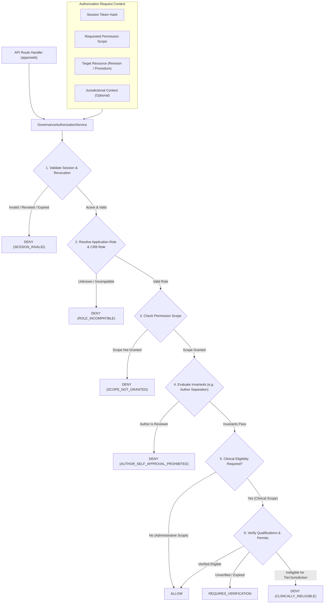
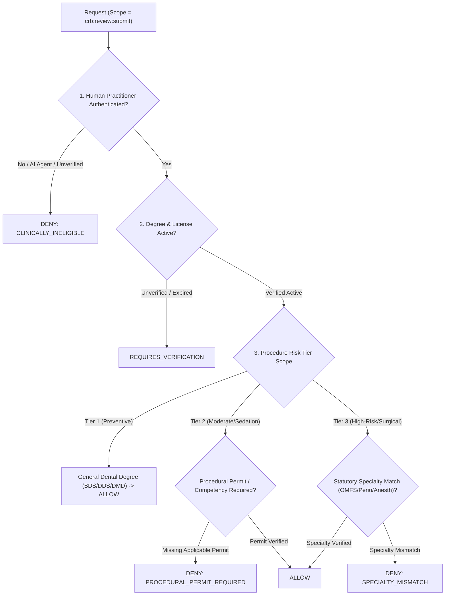
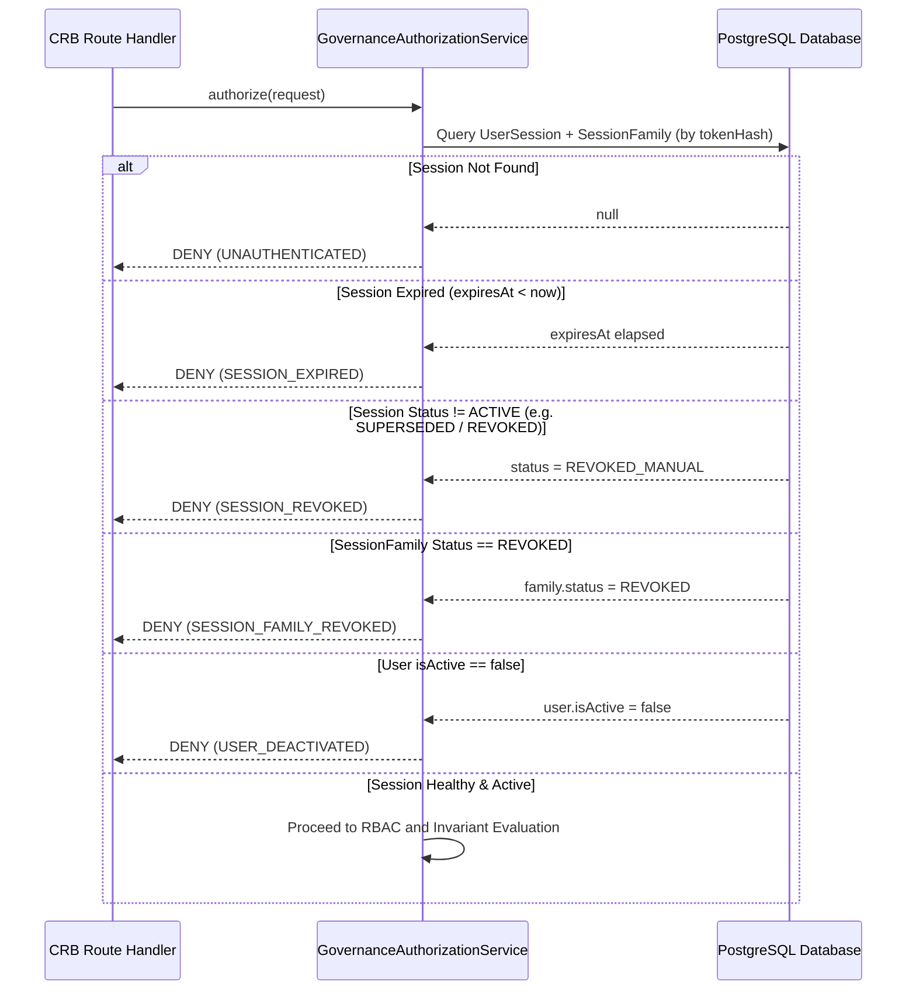

# DentalVis — Phase M6.1.3: Server-Side RBAC & Governance Authorization Service
## Implementation Planning & Technical Architecture Specification

**Architecture Baseline:** v1.9.1 — FROZEN  
**Target Milestone:** M6.1.3 (Third Implementation Sub-Milestone of M6.1)  
**Parent Blueprint:** `docs/architecture/M6_1_GOVERNANCE_SERVICE_LAYER_IMPLEMENTATION_PLAN.md`  
**Foundational Milestones:**
- M6.1.1 (Audit Log Immutability Migration — Commit `e9cb956`)
- M6.1.2 (Governance Core Types & Fail-Closed Policy Adapter — Commit `a874fee`)  
**Status:** Planning & Technical Security Specification Only (Read-Only Planning)  
**Effective Date:** November 24, 2026  
**Target Location:** `packages/database/src/governance/authorizationService.ts`  

---

## 1. Executive Summary

Phase M6.1.3 establishes the core server-side authorization engine for the DentalVis Clinical Review Board (CRB): the **`GovernanceAuthorizationService`**.

Building on the strongly typed domain model and the fail-closed `PolicyConfigurationAdapter` introduced in M6.1.2, this service provides an authoritative, zero-trust server-side boundary that validates all governance operations against:
1. Cryptographically verified user sessions and database revocation records.
2. Application-level RBAC (`UserRole`) mapped strictly to governance operational roles (`CRBRole`).
3. Discrete action permission scopes (`GovernancePermissionScope`) enforcing default-deny semantics.
4. Non-negotiable ethical and clinical invariants (e.g. strict prohibition of author self-approvals).
5. Professional clinical qualifications (BDS/DDS/DMD/MBBS, Statutory Specialties) and statutory procedural permits required for procedure risk tiers (Tier 1, Tier 2, Tier 3) and jurisdictional scopes.
6. Integration with the fail-closed `PolicyConfigurationAdapter` to ensure unratified policies or missing jurisdictional contexts abort authorization immediately.

> [!IMPORTANT]
> **Planning and Design Only:** This document is an implementation plan and architectural specification. No runtime application code, session middleware, Prisma schemas, database migrations, reviewer accounts, or publication states are modified during this phase.

---

## 2. Verified Current Architecture & Repository Inventory

An inspection of the codebase establishes the following baseline facts:

### 2.1 Implemented & Verified Components (`[EXISTING AND VERIFIED]`)
- **`packages/common/src/governance.ts` (M6.1.2):** Defines `ApplicationUserRole`, `CRBRole`, `GovernancePermissionScope`, `ClinicalQualificationDegree`, `StatutorySpecialty`, `StatutoryLicensingAuthority`, `StatutoryProceduralPermit`, `CredentialVerificationStatus`, `JurisdictionalContext`, `ReviewerCredentialState`, `ReviewOutcome`, and `PolicyProvenance`.
- **`packages/database/src/governance/policyAdapter.ts` (M6.1.2):** Server-only `PolicyConfigurationAdapter` enforcing fail-closed policy lookups, provenance preservation, and jurisdictional checks.
- **`packages/database/src/governance/ratifiedPolicies.ts` (M6.1.2):** Concrete in-memory policy registry preserving M4 ratified policies (AI prohibition, author separation, decoupled media, sedation permits, surgical specialty priority) and marking M5 proposals (numerical quorums, 90-day verification window, $1,000 COI threshold, reassessment intervals) as unratified.
- **`packages/database/src/governance/errors.ts` (M6.1.2):** Exports `UnratifiedGovernancePolicyError`, `MissingMandatoryPolicyError`, `MalformedPolicyValueError`, `MissingJurisdictionContextError`, `InvalidPolicyVersionError`, and `UnauthorizedGovernanceActionError`.
- **PostgreSQL Database Invariants (M6.1.1):** Triggers `trg_admin_audit_log_immutable` and `trg_admin_audit_log_truncate` actively protecting `AdminAuditLog` against `UPDATE`, `DELETE`, and `TRUNCATE`.
- **Prisma Session Models:** `UserSession` (with `tokenHash`, `status`, `expiresAt`, `predecessorSessionId`, `successorSessionId`), `SessionFamily` (with `status`, `revokedAt`), and `RevocationEvent` (with polymorphic targets and `ON DELETE RESTRICT` foreign keys).
- **Domain Invariant Guards:** `packages/database/src/domainInvariants.ts` enforcing `enforceNoAuthorSelfApproval()`, session succession validity, and atomic outbox completion.

### 2.2 Conceptual vs Implemented Distinctions

| Feature / Component | Status in Codebase | Role in M6.1.3 |
| :--- | :---: | :--- |
| **Prisma `UserRole`** | `[EXISTING]` | Application-level RBAC enum (5 values). Preserved without schema modification. |
| **Prisma Session Models** | `[EXISTING]` | Active in schema and migration SQL. Ready for database state lookups. |
| **CRB Types & Policy Adapter** | `[EXISTING (M6.1.2)]` | Fully implemented, compiled, and tested in `@dentalvis/common` and `@dentalvis/database`. |
| **`GovernanceAuthorizationService`** | `[MISSING — M6.1.3 TARGET]` | To be designed and planned in this document. |
| **Reviewer Eligibility Engine** | `[MISSING — M6.1.4 TARGET]` | External statutory registry connector; M6.1.3 defines the authorization contract it satisfies. |
| **Admin API Routes (`/api/admin/crb/*`)**| `[MISSING — M6.1.5 TARGET]` | Future consumer of `GovernanceAuthorizationService`. |
| **Session Cookie Middleware** | `[MISSING — M6.1.5 TARGET]` | Browser cookie decoding and CSRF synchronizer handling. |

---

## 3. Current Implementation vs Missing Functionality Gap Analysis

```
┌─────────────────────────────────────────────────────────────────────────────┐
│                       CURRENT REPOSITORY STATE (M6.1.2)                     │
├──────────────────────────────────────┬──────────────────────────────────────┤
│ Implemented & Verified               │ Missing & Required for M6.1.3        │
├──────────────────────────────────────┼──────────────────────────────────────┤
│ • Shared governance taxonomy         │ • Unified Authorization Evaluator    │
│ • Server-only fail-closed adapter    │ • Session revocation DB validation   │
│ • Database audit log immutability    │ • Actor context extraction & typing  │
│ • Unit tests for policy adapter (22) │ • Scope-to-role boundary enforcement │
│ • Static procedure repository default│ • Author self-approval service guard │
│ • Author self-approval unit tests    │ • Typed decision contracts (ALLOW/DENY)│
└──────────────────────────────────────┴──────────────────────────────────────┘
```

---

## 4. Governance Authorization Service Design

The `GovernanceAuthorizationService` is a server-only class residing in `packages/database/src/governance/authorizationService.ts` that provides deterministic, fail-closed authorization decisions.

### 4.1 Zero-Trust Principles
1. **Never Trust Client Claims:** Role, permissions, clinical credentials, session validity, and jurisdiction claims provided by the HTTP client are discarded. All attributes must be resolved from validated server-side tokens, database session records, or verified credential registries.
2. **Default-Deny:** Unless an explicit rule permits the action, access is evaluated as `DENY`.
3. **Fail-Closed on Unratified Policies:** If an operation depends on a governance policy that is currently unratified (e.g. numerical reviewer quorums), authorization fails closed immediately.
4. **Separation of Technical Role vs Clinical Qualification:** A user holding `UserRole.CLINICAL_REVIEWER` has permission to interact with the review queue, but **cannot** approve a specific procedure revision unless their verified clinical qualification, statutory specialty, and procedural permits match the procedure risk tier and jurisdiction.

### 4.2 Architecture & Context Flow



---

## 5. Typed Decision Contract

The service returns a strictly typed, immutable authorization result rather than raw booleans or throwing unhandled errors during standard checks:

```typescript
// packages/database/src/governance/types.ts

export type AuthorizationDecision =
  | 'ALLOW'
  | 'DENY'
  | 'REQUIRES_VERIFICATION';

export type AuthorizationDenialReason =
  | 'UNAUTHENTICATED'
  | 'SESSION_EXPIRED'
  | 'SESSION_REVOKED'
  | 'SESSION_SUPERSEDED'
  | 'SESSION_FAMILY_REVOKED'
  | 'USER_DEACTIVATED'
  | 'ROLE_INCOMPATIBLE'
  | 'SCOPE_NOT_GRANTED'
  | 'AUTHOR_SELF_APPROVAL_PROHIBITED'
  | 'CLINICALLY_INELIGIBLE'
  | 'MISSING_JURISDICTION_CONTEXT'
  | 'UNRATIFIED_MANDATORY_POLICY'
  | 'PROCEDURAL_PERMIT_REQUIRED'
  | 'SPECIALTY_MISMATCH'
  | 'INTERNAL_SECURITY_ERROR';

export interface AuthorizationActor {
  userId: string;
  applicationRole: ApplicationUserRole;
  crbRole: CRBRole;
  sessionId: string;
  sessionFamilyId: string;
}

export interface AuthorizationRequest {
  actor: AuthorizationActor;
  requestedScope: GovernancePermissionScope;
  targetProcedureId?: string;
  targetRevisionId?: string;
  targetAuthorId?: string;
  procedureTier?: GovernanceTier;
  procedureSpecialtyRequirement?: StatutorySpecialty;
  jurisdiction?: JurisdictionalContext;
  reviewerCredentials?: ReviewerCredentialState;
}

export interface AuthorizationResult {
  decision: AuthorizationDecision;
  actorUserId: string;
  requestedScope: GovernancePermissionScope;
  denialReason?: AuthorizationDenialReason;
  diagnosticMessage?: string; // Sanitized; safe for logging
  evaluatedAt: string;        // ISO 8601
}
```

---

## 6. Role-Permission Matrix & Authority Separation

The authorization service enforces a strict, disjoint mapping between technical `ApplicationUserRole`, operational `CRBRole`, and permitted `GovernancePermissionScope`:

### 6.1 Role-Permission Mapping Matrix

| Governance Scope | CONTENT_AUTHOR | CLINICAL_REVIEWER | SPECIALIST_REVIEWER | CRB_CHAIR | GOVERNANCE_ADMIN | PUBLICATION_ADMIN | INDEPENDENT_AUDITOR |
| :--- | :---: | :---: | :---: | :---: | :---: | :---: | :---: |
| `crb:dossier:draft` | **ALLOW** | DENY | DENY | DENY | DENY | DENY | DENY |
| `crb:dossier:read` | **ALLOW** | **ALLOW** | **ALLOW** | **ALLOW** | **ALLOW** | **ALLOW** | **ALLOW** |
| `crb:review:assign` | DENY | DENY | DENY | **ALLOW** | DENY | DENY | DENY |
| `crb:review:accept` | DENY | **ALLOW** | **ALLOW** | DENY | DENY | DENY | DENY |
| `crb:review:assess` | DENY | **ALLOW** | **ALLOW** | DENY | DENY | DENY | DENY |
| `crb:review:submit` | DENY | **ALLOW** | **ALLOW** | DENY | DENY | DENY | DENY |
| `crb:credential:verify`| DENY | DENY | DENY | DENY | **ALLOW** | DENY | DENY |
| `crb:coi:audit` | DENY | **ALLOW** | **ALLOW** | DENY | **ALLOW** | DENY | DENY |
| `crb:publish:authorize`| DENY | DENY | DENY | DENY | DENY | **ALLOW** | DENY |
| `crb:approval:revoke` | DENY | DENY | DENY | **ALLOW** | DENY | DENY | DENY |
| `crb:policy:read` | DENY | DENY | DENY | **ALLOW** | **ALLOW** | **ALLOW** | **ALLOW** |
| `crb:audit:read` | DENY | DENY | DENY | **ALLOW** | **ALLOW** | **ALLOW** | **ALLOW** |

### 6.2 Authority Separation Safeguards
1. **Independent Auditor Read-Only Boundary:**
   - The Independent Auditor is granted strictly `crb:dossier:read`, `crb:policy:read`, and `crb:audit:read`.
   - All mutation actions (`crb:review:submit`, `crb:publish:authorize`, `crb:approval:revoke`, `crb:credential:verify`, `crb:dossier:draft`) evaluate to `DENY` with reason `SCOPE_NOT_GRANTED`.
2. **CRB Chair vs Publication Administrator Separation:**
   - Although both may map to the technical role `CHIEF_EDITOR` in the database, `CRB_CHAIR` **cannot** execute `crb:publish:authorize`.
   - Conversely, `PUBLICATION_ADMIN` **cannot** assign reviews, submit clinical decisions, or revoke approvals.
   - No implicit privilege inheritance exists between editorial roles.
3. **Content Author Self-Approval Prohibition:**
   - Even if a user with `CLINICAL_AUTHOR` also holds credentials as a `CLINICAL_REVIEWER`, the service enforces `targetAuthorId !== actor.userId`. Any attempt to evaluate or approve their own revision evaluates to `DENY` with reason `AUTHOR_SELF_APPROVAL_PROHIBITED`.

---

## 7. Clinical Eligibility Integration

The authorization service evaluates clinical review permissions (`crb:review:assess`, `crb:review:submit`) through a three-stage clinical qualification check:



### 7.1 Sedation Policy Integration (Ratified M4 Protocol)
When authorizing review actions on sedation procedures (e.g. `#48 Oral Sedation`, `#49 Deep IV Sedation`):
- The service retrieves the ratified policy `governance:sedation_permits` via `PolicyConfigurationAdapter.getSedationPolicy(jurisdiction)`.
- If `jurisdiction` is missing, the service immediately denies with `MISSING_JURISDICTION_CONTEXT`.
- For Tier 3 Deep Sedation, the reviewer's credentials must contain either `DENTAL_ANESTHESIOLOGY` or `ORAL_AND_MAXILLOFACIAL_SURGERY`, plus the applicable parenteral sedation permit.
- Arbitrary tenure thresholds (such as 5-year rules) are strictly rejected per M4.

### 7.2 Surgical Specialist Priority (Ratified M4 Protocol)
When authorizing reviews on Tier 3 surgical content (Sinus Lift, Ridge Augmentation, Full Arch):
- The service retrieves `governance:surgical_specialty`.
- The reviewer must possess statutory specialty recognition in `ORAL_AND_MAXILLOFACIAL_SURGERY` or `PERIODONTICS`. Commercial implantology certificates are rejected as standalone qualification.

---

## 8. Session Security Dependencies & Invalidation Lifecycle

`GovernanceAuthorizationService` depends on synchronous database validation of session state for high-privilege governance actions:



### Key Session Rules for M6.1.3
1. **Direct Database Lookups for Governance Mutations:** High-privilege actions (`crb:publish:authorize`, `crb:approval:revoke`, `crb:review:submit`) must not rely solely on stateless JWT claims; they must verify `UserSession.status === 'ACTIVE'` and `SessionFamily.status === 'ACTIVE'` against the database.
2. **Replay Detection Awareness:** If a session record is marked `SUPERSEDED`, authorization is denied with `SESSION_SUPERSEDED`, requiring immediate token rotation.
3. **Session Fencing:** In distributed deployments, if a worker's local revocation cursor is behind `RevocationConsumer.fencingGeneration`, cached authorization leases are invalidated fail-closed.
4. **Boundary Note:** Actual HTTP cookie parsing, JWT signature verification, and CSRF header checks belong to the API gateway layer (**M6.1.5**). M6.1.3 consumes validated session tokens and context objects.

---

## 9. Fail-Closed Error Handling & Sanitization

All authorization failures fail closed:

1. **Unexpected Exceptions:** If the database connection drops or a query fails during authorization evaluation, the service catches the error, logs the diagnostic detail to `AdminAuditLog` with action `CRB_UNAUTHORIZED_ACCESS_BLOCKED`, and returns `DENY` with reason `INTERNAL_SECURITY_ERROR`.
2. **No Information Leakage:** Public API responses receive standard HTTP status codes:
   - `UNAUTHENTICATED`, `SESSION_EXPIRED`, `SESSION_REVOKED` -> HTTP 401 Unauthorized.
   - `SCOPE_NOT_GRANTED`, `AUTHOR_SELF_APPROVAL_PROHIBITED`, `CLINICALLY_INELIGIBLE` -> HTTP 403 Forbidden.
   - Internal stack traces, SQL error codes, and server memory details are never returned in client payloads.
3. **Unratified Mandatory Policies:** If an authorization check queries an unratified M5 policy (e.g. quorum counts), the policy adapter throws `UnratifiedGovernancePolicyError`, which the authorization service handles by returning `DENY` with reason `UNRATIFIED_MANDATORY_POLICY`.

---

## 10. Proposed File & Module Architecture

```
packages/database/src/governance/
├── index.ts                     <-- Re-exports authorization service and types
├── errors.ts                    <-- Existing M6.1.2 errors + authorization errors
├── types.ts                     <-- AuthorizationRequest, AuthorizationResult, Scopes
├── ratifiedPolicies.ts          <-- Existing M6.1.2 ratified policies map
├── policyAdapter.ts             <-- Existing M6.1.2 PolicyConfigurationAdapter
├── authorizationService.ts      <-- PROPOSED: GovernanceAuthorizationService
└── sessionValidator.ts          <-- PROPOSED: Synchronous session and family validator

packages/database/test/
├── policyAdapter.test.ts        <-- Existing M6.1.2 policy adapter tests (22)
└── authorizationService.test.ts <-- PROPOSED: M6.1.3 authorization test suite (25+)
```

---

## 11. Comprehensive Testing Strategy

The test suite for `packages/database/test/authorizationService.test.ts` will cover 25 distinct scenarios:

### 11.1 Test Matrix

| Test ID | Category | Scenario / Inputs | Expected Result |
| :--- | :--- | :--- | :--- |
| **TEST-AUTHZ-01** | Identity & Session | Valid active session for `SYSTEM_ADMIN` requesting `crb:credential:verify` | `ALLOW` |
| **TEST-AUTHZ-02** | Identity & Session | Missing / null actor session token | `DENY` (`UNAUTHENTICATED`) |
| **TEST-AUTHZ-03** | Identity & Session | Expired session (`expiresAt` in past) | `DENY` (`SESSION_EXPIRED`) |
| **TEST-AUTHZ-04** | Identity & Session | Session marked `REVOKED_MANUAL` | `DENY` (`SESSION_REVOKED`) |
| **TEST-AUTHZ-05** | Identity & Session | Session marked `SUPERSEDED` (replayed token) | `DENY` (`SESSION_SUPERSEDED`) |
| **TEST-AUTHZ-06** | Identity & Session | SessionFamily marked `REVOKED` | `DENY` (`SESSION_FAMILY_REVOKED`) |
| **TEST-AUTHZ-07** | Identity & Session | User account marked `isActive: false` | `DENY` (`USER_DEACTIVATED`) |
| **TEST-AUTHZ-08** | Auditor Boundary | Independent Auditor requesting `crb:dossier:read` | `ALLOW` |
| **TEST-AUTHZ-09** | Auditor Boundary | Independent Auditor requesting `crb:review:submit` | `DENY` (`SCOPE_NOT_GRANTED`) |
| **TEST-AUTHZ-10** | Auditor Boundary | Independent Auditor requesting `crb:publish:authorize` | `DENY` (`SCOPE_NOT_GRANTED`) |
| **TEST-AUTHZ-11** | Auditor Boundary | Independent Auditor requesting `crb:approval:revoke` | `DENY` (`SCOPE_NOT_GRANTED`) |
| **TEST-AUTHZ-12** | Editorial Scope | CRB Chair requesting `crb:review:assign` | `ALLOW` |
| **TEST-AUTHZ-13** | Editorial Scope | CRB Chair requesting `crb:publish:authorize` | `DENY` (`SCOPE_NOT_GRANTED`) |
| **TEST-AUTHZ-14** | Publication Scope | Publication Admin requesting `crb:publish:authorize` | `ALLOW` |
| **TEST-AUTHZ-15** | Publication Scope | Publication Admin requesting `crb:review:submit` | `DENY` (`SCOPE_NOT_GRANTED`) |
| **TEST-AUTHZ-16** | Publication Scope | Publication Admin requesting `crb:approval:revoke` | `DENY` (`SCOPE_NOT_GRANTED`) |
| **TEST-AUTHZ-17** | Author Invariant | Author reviewing own procedure (`authorId === actorId`) | `DENY` (`AUTHOR_SELF_APPROVAL_PROHIBITED`) |
| **TEST-AUTHZ-18** | Author Invariant | Author drafting own procedure (`crb:dossier:draft`) | `ALLOW` |
| **TEST-AUTHZ-19** | Clinical Scope | Unverified reviewer requesting `crb:review:submit` | `REQUIRES_VERIFICATION` |
| **TEST-AUTHZ-20** | Clinical Scope | General Dentist reviewing Tier 3 OMFS surgical procedure | `DENY` (`SPECIALTY_MISMATCH`) |
| **TEST-AUTHZ-21** | Clinical Scope | OMFS Specialist reviewing Tier 3 surgical procedure | `ALLOW` |
| **TEST-AUTHZ-22** | Sedation Scope | Dentist without permit reviewing Tier 2 Oral Sedation | `DENY` (`PROCEDURAL_PERMIT_REQUIRED`) |
| **TEST-AUTHZ-23** | Sedation Scope | Sedation review requested without jurisdictional context | `DENY` (`MISSING_JURISDICTION_CONTEXT`) |
| **TEST-AUTHZ-24** | Policy Gating | Action dependent on unratified policy (e.g. proposed quorum) | `DENY` (`UNRATIFIED_MANDATORY_POLICY`) |
| **TEST-AUTHZ-25** | Robustness | Database query error during session check | `DENY` (`INTERNAL_SECURITY_ERROR`) |

---

## 12. Security Threat & Boundary Analysis

1. **Client Role Spoofing Threat:** An attacker modifies client-side JavaScript or HTTP headers to claim `crbRole: 'CHIEF_EDITOR'`.  
   *Mitigation:* The authorization service strictly resolves `CRBRole` and permissions from the database user record associated with the authenticated `tokenHash`.
2. **Session Hijacking & Replay Threat:** An attacker attempts to use a superseded refresh token or revoked session cookie.  
   *Mitigation:* Synchronous session validation confirms `status === 'ACTIVE'` on every mutating governance request. Replays trigger `SESSION_SUPERSEDED` and family revocation.
3. **Privilege Creep Threat:** An administrative user (`SYSTEM_ADMIN`) attempts to sign off on a clinical procedure.  
   *Mitigation:* `SYSTEM_ADMIN` is mapped to `GOVERNANCE_ADMIN`, which has zero clinical review scopes (`crb:review:submit` evaluates to `DENY`).
4. **Clinical Misrepresentation Threat:** A clinician claims specialist status on Tier 3 content without statutory board certification.  
   *Mitigation:* The service enforces specialty matching against the verified credential record; unverified or mismatched specialties fail closed.

---

## 13. Implementation Sequence for Future Authorized Execution

When implementation authorization is granted for M6.1.3, work will proceed in four discrete stages:

1. **Stage 1: Types & Session Validator (`packages/database/src/governance/`):**
   - Implement `sessionValidator.ts` providing synchronous session, family, and revocation checks against PostgreSQL via Prisma.
   - Define `AuthorizationRequest`, `AuthorizationResult`, and denial reason enums.
2. **Stage 2: Core Authorization Service Implementation:**
   - Implement `GovernanceAuthorizationService` in `packages/database/src/governance/authorizationService.ts` using `import 'server-only'`.
   - Wire in `PolicyConfigurationAdapter` and `domainInvariants.ts` guards.
3. **Stage 3: Comprehensive Unit & Integration Testing:**
   - Implement `packages/database/test/authorizationService.test.ts` covering all 25 test cases.
   - Run `pnpm --filter @dentalvis/database test`.
4. **Stage 4: Workspace Validations & Documentation:**
   - Execute workspace typecheck (`pnpm typecheck`), database tests, and web build.
   - Update M6.1.3 documentation with execution metrics and commit/push.

---

## 14. Scope Exclusions & Downstream Dependencies

### Excluded from M6.1.3
- **No External Credential Registry Integration:** M6.1.3 accepts verified credential records as input; the active registry crawler and license lookup engine belong to **M6.1.4**.
- **No HTTP API Route Handlers:** Writing Next.js API routes (`/api/admin/crb/*`) and cookie middleware belongs to **M6.1.5**.
- **No Database Schema Changes:** No migrations or Prisma changes are needed.

### Prerequisites for M6.1.4 Readiness
- Completion of M6.1.3 ensures that when `ReviewerEligibilityService` and `ClinicalReviewService` are introduced in M6.1.4, they have an authoritative authorization evaluator to enforce default-deny guards.

---

## 15. Acceptance Criteria for Phase M6.1.3 Implementation

When authorization to implement M6.1.3 is provided, the work will be considered acceptable if and only if:
1. **Server-Only Enforcement:** `GovernanceAuthorizationService` imports `'server-only'` and cannot be bundled into client builds.
2. **Zero Schema Modifications:** Prisma schema and database tables remain 100% frozen.
3. **Role & Action Separation Passing:** All 25 test matrix scenarios pass cleanly.
4. **Auditor Read-Only Enforced:** Independent Auditor has zero mutation authority.
5. **Author Self-Approval Enforced:** Authors cannot approve their own revisions.
6. **Existing Suites Pass:** All 134 existing database tests, workspace typecheck, and Next.js builds continue to pass with zero regressions.

---

## 16. Explicit Implementation Authorization Checklist

To be completed only when formal authorization to execute M6.1.3 is provided:

- [ ] Project owner explicitly authorizes M6.1.3 implementation.
- [ ] Working tree inspected and confirmed clean of unintended modifications.
- [ ] `sessionValidator.ts` implemented in `packages/database/src/governance/`.
- [ ] `authorizationService.ts` implemented in `packages/database/src/governance/`.
- [ ] Test suite `authorizationService.test.ts` implemented and passing 100% (25/25).
- [ ] Workspace typecheck and Next.js build pass cleanly.
- [ ] Git commit and push executed cleanly.

---

### Phase M6.1.3 Recommendation

**Verdict: `M6.1.3 READY FOR IMPLEMENTATION AUTHORIZATION`**

*(This document provides the complete technical execution blueprint for Phase M6.1.3. Execution remains blocked pending explicit user authorization.)*
