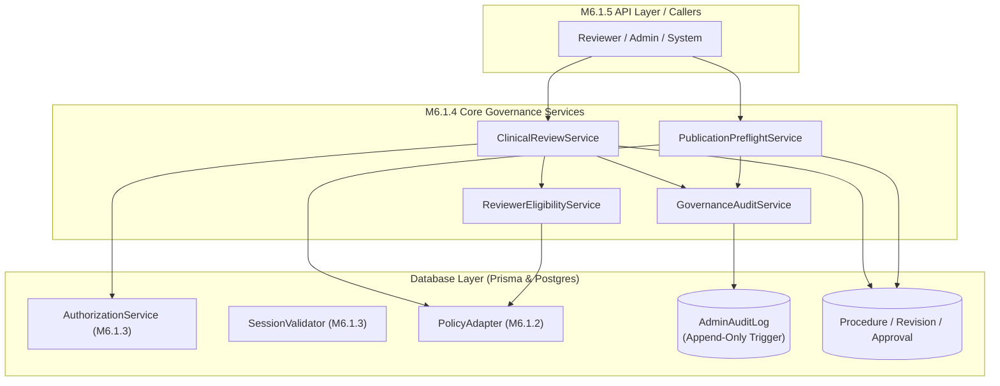
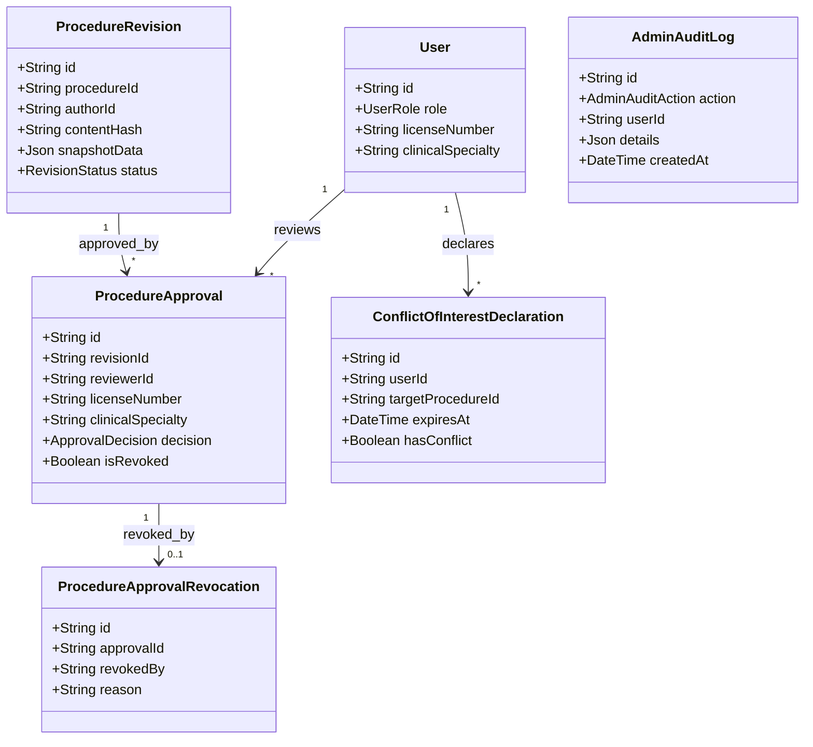
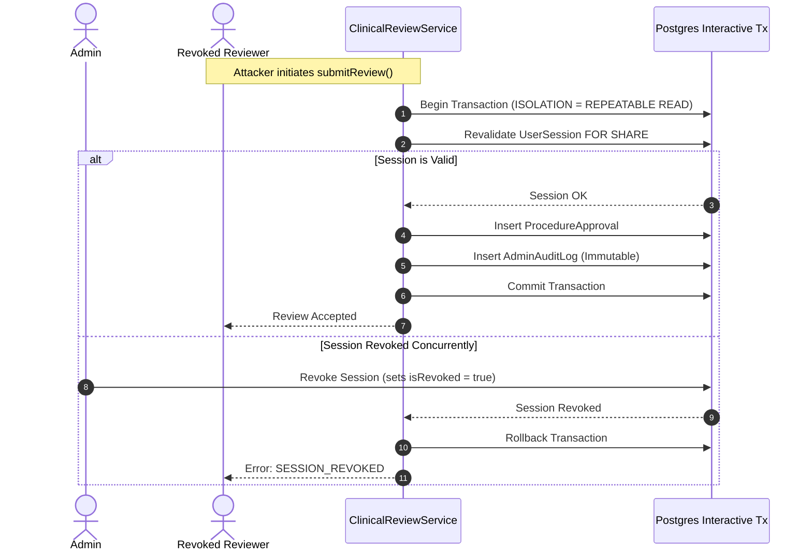
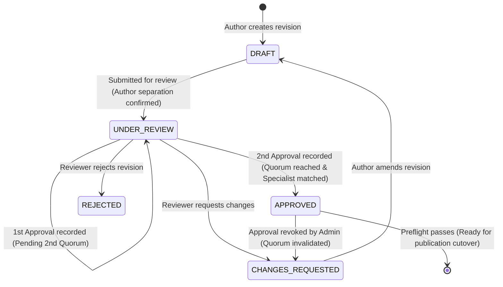
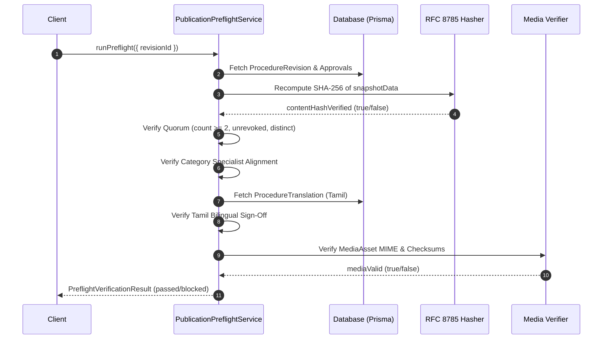
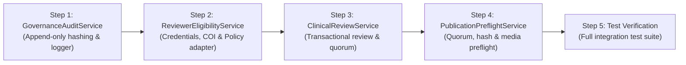

# DentalVis — M6.1.4 Governance Services Core Architecture & Implementation Plan

**Baseline Architecture:** v1.9.1 (FROZEN)  
**Accepted Milestones:** M6.1.1 (Audit Immutability), M6.1.2 (Core Governance Types & Policy Adapter), M6.1.3 (Server-Side RBAC & Governance Authorization Service)  
**M6.1.3 Audit Verdict:** `SECURITY AUDIT ACCEPTED — READY FOR M6.1.4 PLANNING` (Commit `48314ef`)  
**Target Milestone:** M6.1.4 — Core Governance Services (`ReviewerEligibilityService`, `ClinicalReviewService`, `GovernanceAuditService`, `PublicationPreflightService`)  
**Status:** PLANNING & READINESS ASSESSMENT ONLY (No implementation code, no migrations, no DB mutation)  
**Repository:** https://github.com/hariiii8/DentalVis  
**Branch:** `master`

---

## 1. Executive Summary

Milestone M6.1.4 establishes the core server-side clinical governance services that mediate between authenticated, authorized actors (established in M6.1.3) and the clinical data lifecycle (content creation, peer review, revision tracking, conflict-of-interest declarations, audit logging, and publication gating).

The scope encompasses four specialized, decoupled services:
1. **`ReviewerEligibilityService`:** Evaluates clinical reviewers against procedure scope, recognized specialty credentials, statutory licensing, jurisdiction, and unexpired conflict-of-interest declarations. It enforces context-sensitive qualification without imposing universal, unratified credential mandates.
2. **`ClinicalReviewService`:** Manages the structured clinical peer-review lifecycle, including reviewer assignments, review submissions, two-signature quorum verification, author-reviewer separation, and revocation of invalid approvals.
3. **`GovernanceAuditService`:** Provides fail-closed, append-only cryptographic audit recording over PostgreSQL's trigger-enforced `AdminAuditLog`, computing canonical RFC 8785 JSON hashes over immutable audit payloads.
4. **`PublicationPreflightService`:** Gathers and evaluates all publication gating prerequisites (two-signature clinical quorum, specialist matching, Tamil linguistic sign-off, canonical content-hash integrity, and media asset validation) without publishing content itself.

This document delivers a complete architectural blueprint, data-model mapping, transaction boundary analysis, security threat model, and test matrix for M6.1.4.

---

## 2. Frozen Architecture Baseline & Scope Reconciliation

### 2.1 Baseline Invariants
- **Architecture Baseline:** v1.9.1 is frozen. The public frontend, UI routing, static procedure catalog, and clinical display layers remain untouched.
- **Provider Flag Invariant:** `DENTALVIS_PROCEDURE_PROVIDER=static` remains the default fallback throughout all test runs and runtime environments until cutover.
- **Prisma Schema Stability:** In M6.1.4 planning, we evaluate schema additions strictly through necessity: **Essential**, **Optional**, or **Avoidable through Existing Models**. No breaking alterations to existing tables are permitted.
- **Fail-Closed Governance Invariant:** Any missing credential, unratified policy lookup, unverified session, or failed transaction rollback results in explicit denial.

### 2.2 Scope Reconciliation
The M6.1.4 scope is strictly limited to the four core services. It explicitly excludes:
- HTTP API route handlers (`/api/governance/*`) — deferred to M6.1.5.
- Admin portal UI components and interactive review dashboards — deferred to M6.2.
- Public publication cutover or dynamic catalog serving — deferred to M6.2.
- Direct automated publishing by the preflight service (preflight is strictly read-only validation).

---

## 3. Existing Implementation Inventory

The M6.1.4 services build directly upon verified primitives in the repository:

| Component | Path | Status | Reused Functionality |
| :--- | :--- | :--- | :--- |
| **Audit Immutability Triggers** | `packages/database/prisma/migrations/20261124_m6_1_1_audit_log_immutability` | Accepted (M6.1.1) | PostgreSQL `trg_admin_audit_log_immutable` and `enforce_append_only()` trigger protecting `AdminAuditLog`. |
| **Governance Types** | `packages/common/src/governance.ts` | Accepted (M6.1.2) | `GovernanceIdentity`, `ClinicalReviewDossier`, `ConflictOfInterestDeclaration`, `PreflightVerificationResult`, `PolicyProvenance`. |
| **Policy Adapter** | `packages/database/src/governance/policyAdapter.ts` | Accepted (M6.1.2) | Fail-closed policy evaluation, hash verification, version provenance (`M5-POL-001`, `M4-POL-002`, `M5-POL-003`). |
| **Session Validator** | `packages/database/src/governance/sessionValidator.ts` | Accepted (M6.1.3) | `validateSessionAuthoritative()`, checking session validity, user suspension, session revocation, and expiration. |
| **Authorization Service** | `packages/database/src/governance/authorizationService.ts` | Accepted (M6.1.3) | `authorizeGovernanceAction()`, checking role mapping, permission scopes, author-reviewer separation, and contextual eligibility. |
| **Prisma Schema Models** | `packages/database/prisma/schema.prisma` | Existing | `User`, `UserSession`, `AdminAuditLog`, `Procedure`, `ProcedureRevision`, `ProcedureApproval`, `ProcedureApprovalRevocation`, `MediaAsset`. |

---

## 4. M6.1.3 Security Audit Finding Disposition

The independent security audit of M6.1.3 (commit `48314ef`) identified three architectural findings. M6.1.4 formally carries forward and resolves each finding:

### 4.1 Finding SEC-M6.1.3-01 (LOW): Sedation Procedure Heuristic
- **Finding:** In `authorizationService.ts`, procedure risk assessment for sedation relied on string matching: `targetProcedureId.toLowerCase().includes('sedation')`.
- **M6.1.4 Resolution:** In `ReviewerEligibilityService` and `ClinicalReviewService`, procedure risk tier and sedation requirements must be resolved from structured procedure metadata (e.g., `ProcedureRevision.snapshotData.clinicalMetadata.riskTier` or `Procedure.category`), not naive substring heuristics. When metadata is absent or unparseable, the service defaults fail-closed to `RiskTier.TIER_3` or rejects the operation.

### 4.2 Finding SEC-M6.1.3-02 (INFO): Distributed Fencing-Generation Checks
- **Finding:** Single-node in-memory revocation cache lacks distributed fencing tokens across worker processes.
- **M6.1.4 Resolution:** While M6.1.4 executes within Node.js database services, service methods accepting mutations (`ClinicalReviewService.submitReview`, `ClinicalReviewService.revokeApproval`) must read the authoritative `UserSession` and `SessionRevocation` state within the interactive database transaction (`prisma.$transaction`) or via `SessionValidator.validateSessionAuthoritative()`, ensuring multi-process consistency without relying solely on local memory caches.

### 4.3 Finding SEC-M6.1.3-03 (INFO): Authorization-to-Mutation Revocation Race
- **Finding:** A user session could theoretically be revoked in the microsecond window between `authorizeGovernanceAction()` completing and the database mutation executing.
- **M6.1.4 Resolution:** All mutating operations in `ClinicalReviewService` must execute within a PostgreSQL interactive transaction with `SERIALIZABLE` or `REPEATABLE READ` isolation, or perform an atomic session revalidation query (`SELECT "isRevoked", "expiresAt" FROM "UserSession" WHERE "id" = ... FOR SHARE`) inside the same transaction prior to inserting the approval or revision.

---

## 5. Service Boundaries, Responsibilities & Exclusions



### 5.1 Service 1: `ReviewerEligibilityService`

#### Primary Responsibilities:
1. **Context-Sensitive Credential Evaluation:** Evaluates whether a designated reviewer possesses the requisite qualifications for a specific procedure revision based on jurisdiction, procedure scope, recognized specialty, and statutory license status.
2. **Conflict of Interest (COI) Verification:** Checks that the reviewer has an active, unexpired COI declaration on file and that no conflicting relationships (author of content, financial interest, institutional bias) exist for the target procedure.
3. **Specialty Alignment:** Validates whether the reviewer's recognized clinical specialty matches the procedure category (e.g., Endodontics for Root Canal Therapy, Oral & Maxillofacial Surgery for Surgical Extractions, Periodontics for Gingival Grafting).
4. **Sedation Qualification Policy (`M4-POL-002`):** Verifies applicable sedation permits and training when the procedure involves sedation, without imposing blanket or arbitrary experience rules.
5. **Fail-Closed Determination:** Returns a strongly typed `ReviewerEligibilityResult` with explicit denial reasons whenever any qualification or COI verification fails.

#### Explicit Exclusions:
- Does not authenticate sessions or check user passwords (owned by `SessionValidator`).
- Does not grant permission scopes or check RBAC identities (owned by `AuthorizationService`).
- Does not create or update user profile credentials in the database (owned by User Admin management).
- Does not issue review decisions or persist approvals (owned by `ClinicalReviewService`).

---

### 5.2 Service 2: `ClinicalReviewService`

#### Primary Responsibilities:
1. **Review Lifecycle Management:** Manages the transition of procedure revisions through review states (`DRAFT` → `UNDER_REVIEW` → `APPROVED` / `CHANGES_REQUESTED` / `REJECTED`).
2. **Reviewer Assignment:** Assigns eligible clinical reviewers to pending revisions, enforcing author-reviewer separation (`reviewerId !== revision.authorId`).
3. **Review Submission & Quorum Tracking:** Records peer review decisions (`ProcedureApproval`), verifying that two distinct, eligible clinical signatures are obtained before reaching `APPROVED` quorum.
4. **Signature Revocation:** Handles the formal revocation of an approval (`ProcedureApprovalRevocation`) when reviewer credentials expire, misconduct is discovered, or clinical consensus shifts, returning the revision to `CHANGES_REQUESTED`.
5. **Transactional Integrity:** Executes review submission, approval recording, and audit emission within an atomic database transaction.

#### Explicit Exclusions:
- Does not publish content to public routes or modify public static caches (owned by Publication cutover / M6.2).
- Does not author or edit procedure markdown/JSON content (owned by Content Authoring).
- Does not evaluate statutory licensing rules from scratch (delegates to `ReviewerEligibilityService`).

---

### 5.3 Service 3: `GovernanceAuditService`

#### Primary Responsibilities:
1. **Cryptographic Payload Hashing:** Computes canonical SHA-256 hashes of audit event payloads using RFC 8785 canonical JSON formatting before database insertion.
2. **Immutable Audit Emission:** Writes audit records to the PostgreSQL `AdminAuditLog` table, relying on the database trigger `trg_admin_audit_log_immutable` for tamper-resistance.
3. **Contextual Correlation:** Captures actor ID, session family, authoritative IP address, user agent, target entity, action enum, and policy version provenance.
4. **Audit Querying & Verification:** Provides read-only query capabilities for governance auditors to verify the integrity and historical sequence of audit trails without providing update or delete APIs.

#### Explicit Exclusions:
- No update, delete, or truncate methods exist under any circumstance (enforced by code and PostgreSQL trigger).
- Does not perform authorization checks for target business operations (owned by `AuthorizationService`).
- Does not manage session lifecycle (owned by `SessionValidator`).

---

### 5.4 Service 4: `PublicationPreflightService`

#### Primary Responsibilities:
1. **Quorum Verification:** Validates that the procedure revision has at least two valid, unrevoked approvals from distinct clinical reviewers.
2. **Specialist Match Verification:** Verifies that at least one approving reviewer possesses a recognized specialty matching the procedure category.
3. **Tamil Translation Preflight:** Verifies that Tamil procedure translations (`ProcedureTranslation`) have been reviewed and signed off by a qualified bilingual reviewer, checking linguistic consistency.
4. **RFC 8785 Content Hash Integrity:** Recalculates the SHA-256 hash of the canonicalized revision `snapshotData` and asserts equality with `contentHash`.
5. **Media Asset Integrity:** Validates that all associated media assets (anatomy diagrams, step illustrations) exist, have valid MIME types, and pass checksum verification.
6. **Preflight Dossier Generation:** Produces a comprehensive `PreflightVerificationResult` summarizing all checks, blocking publication if any check fails.

#### Explicit Exclusions:
- **STRICTLY NON-PUBLISHING:** Does not update procedure published status, does not switch public flags, and does not alter the static runtime catalog.
- Does not create revisions or approvals.
- Does not bypass failed checks under any admin override.

---

## 6. Service Contracts & Proposed Types

### 6.1 `ReviewerEligibilityService` Contract

```typescript
export interface ReviewerEligibilityContext {
  procedureId: string;
  category: string;
  riskTier: RiskTier;
  requiresSedation: boolean;
  jurisdiction: string;
}

export interface ReviewerEligibilityResult {
  isEligible: boolean;
  reviewerId: string;
  matchedSpecialty?: string;
  hasValidLicense: boolean;
  hasSedationPermit?: boolean;
  coiStatus: 'VALID' | 'EXPIRED' | 'CONFLICT_DETECTED' | 'MISSING';
  denialReasons: string[];
  evaluatedPolicyVersions: Record<string, string>;
}

export interface IReviewerEligibilityService {
  evaluateEligibility(
    reviewerId: string,
    context: ReviewerEligibilityContext
  ): Promise<ReviewerEligibilityResult>;

  verifyConflictOfInterest(
    reviewerId: string,
    procedureId: string
  ): Promise<{ valid: boolean; reason?: string }>;
}
```

### 6.2 `ClinicalReviewService` Contract

```typescript
export interface SubmitReviewInput {
  revisionId: string;
  reviewerSessionId: string;
  decision: 'APPROVED' | 'CHANGES_REQUESTED' | 'REJECTED';
  clinicalNotes: string;
  coiDeclarationId?: string;
  ipAddress?: string;
  userAgent?: string;
}

export interface ReviewSubmissionResult {
  approvalId: string;
  revisionId: string;
  status: 'QUORUM_REACHED' | 'PENDING_SECOND_REVIEW' | 'REJECTED' | 'CHANGES_REQUESTED';
  totalApprovals: number;
  auditLogId: string;
}

export interface RevokeApprovalInput {
  approvalId: string;
  revokingAdminSessionId: string;
  reason: string;
  ipAddress?: string;
  userAgent?: string;
}

export interface IClinicalReviewService {
  submitReview(input: SubmitReviewInput): Promise<ReviewSubmissionResult>;
  revokeApproval(input: RevokeApprovalInput): Promise<{ revocationId: string; revisionStatus: string }>;
  getDossier(revisionId: string): Promise<ClinicalReviewDossier>;
}
```

### 6.3 `GovernanceAuditService` Contract

```typescript
export interface EmitAuditEventInput {
  action: AdminAuditAction;
  actorId: string;
  sessionId?: string;
  resourceId?: string;
  resourceType: string;
  payload: Record<string, unknown>;
  ipAddress?: string;
  userAgent?: string;
  policyVersions?: Record<string, string>;
}

export interface AuditVerificationRecord {
  id: string;
  action: AdminAuditAction;
  timestamp: Date;
  actorId: string;
  payloadHash: string;
  isIntegrityVerified: boolean;
}

export interface IGovernanceAuditService {
  emitAuditEvent(
    input: EmitAuditEventInput,
    tx?: Prisma.TransactionClient
  ): Promise<{ auditId: string; payloadHash: string }>;

  verifyAuditIntegrity(auditId: string): Promise<AuditVerificationRecord>;

  queryAuditTrail(criteria: {
    resourceId?: string;
    actorId?: string;
    from?: Date;
    to?: Date;
    limit?: number;
  }): Promise<AuditVerificationRecord[]>;
}
```

### 6.4 `PublicationPreflightService` Contract

```typescript
export interface PreflightCheckCriteria {
  revisionId: string;
  targetLocale?: string;
  requireMediaChecksumVerification?: boolean;
}

export interface PreflightVerificationResult {
  passed: boolean;
  revisionId: string;
  procedureId: string;
  contentHashVerified: boolean;
  calculatedContentHash: string;
  approvalsSummary: {
    totalValidApprovals: number;
    quorumMet: boolean;
    approvers: Array<{
      reviewerId: string;
      specialty: string;
      licenseNumber: string;
      approvedAt: Date;
    }>;
  };
  specialistMatch: {
    matched: boolean;
    category: string;
    specialistId?: string;
  };
  tamilTranslationStatus?: {
    present: boolean;
    reviewedBy?: string;
    approved: boolean;
  };
  mediaVerification: {
    totalAssets: number;
    allAssetsValid: boolean;
    invalidAssets: string[];
  };
  blockingDeficiencies: string[];
  generatedAt: Date;
}

export interface IPublicationPreflightService {
  runPreflight(criteria: PreflightCheckCriteria): Promise<PreflightVerificationResult>;
}
```

---

## 7. Database Model Mapping & Schema Gap Analysis

To maintain architectural stability and avoid unnecessary schema churn, proposed schema modifications are classified into three strict tiers:



### 7.1 Gap Analysis Table

| Domain Requirement | Existing Prisma Model / Field | Proposed Schema Addition | Classification | Recommendation & Mitigation |
| :--- | :--- | :--- | :--- | :--- |
| **Review Decisions & Approvals** | `ProcedureApproval` (has `reviewerId`, `licenseNumber`, `clinicalSpecialty`, `decision`, `isRevoked`) | None required for basic quorum. | **Avoidable** | Existing `ProcedureApproval` model is fully sufficient for quorum tracking. |
| **Approval Revocation** | `ProcedureApprovalRevocation` (has `approvalId`, `revokedBy`, `reason`) | None required. | **Avoidable** | Existing model captures complete revocation provenance. |
| **Audit Log Hashing** | `AdminAuditLog` (`details: Json`) | Field `payloadHash: String?` | **Optional** | The payload hash can be computed via RFC 8785 and stored inside the existing JSON `details` field (e.g. `details.payloadHash`), avoiding schema migration while retaining full cryptographic verifiability. |
| **Conflict of Interest Tracking** | Stored in `snapshotData` / Audit logs | Model `ConflictOfInterestDeclaration` | **Optional / Deferred** | COI declarations can be structured as verified metadata inside `AdminAuditLog` or `ProcedureApproval.clinicalNotes` for M6.1.4, or introduced as a dedicated model in M6.1.5 when full reviewer portal profiles are added. |
| **Dossier State Machine** | `ProcedureRevision.status` (`DRAFT`, `UNDER_REVIEW`, `APPROVED`, `CHANGES_REQUESTED`, `REJECTED`) | Model `ClinicalReviewDossier` | **Avoidable** | `ProcedureRevision` already acts as the persistence entity for revision state. Dossiers are virtual aggregations assembled on-demand by `ClinicalReviewService.getDossier()`. |
| **Reviewer Assignment Queue** | None in DB | Model `ReviewerAssignment` | **Optional / Deferred** | In M6.1.4, assignments can be managed via `AdminAuditLog` action `REVIEWER_ASSIGNED` and queryable via audit history, deferring dedicated table creation to M6.2. |

> [!IMPORTANT]
> **Schema Migration Verdict for M6.1.4:**  
> M6.1.4 can be fully implemented **without requiring a disruptive Prisma schema migration**, by leveraging existing `ProcedureRevision`, `ProcedureApproval`, `ProcedureApprovalRevocation`, and `AdminAuditLog` models, embedding cryptographic hashes into `AdminAuditLog.details`.

---

## 8. Ratified Policy Dependencies & Unratified Policy Exclusions

M6.1.4 services strictly depend on ratified governance policies loaded via `PolicyConfigurationAdapter` (M6.1.2):

1. **`M5-POL-001` (Two-Signature Clinical Review Quorum):**
   - Requires exactly two distinct, verified clinical reviewer approvals before a revision reaches `APPROVED` status.
   - Enforces author-reviewer separation (`reviewerId !== revision.authorId`).
2. **`M4-POL-002` (Sedation Procedural Qualifications):**
   - Applies only when procedure involves sedation.
   - Requires verified jurisdiction-specific sedation permits and training; does **not** enforce blanket 5-year experience mandates.
3. **`M5-POL-003` (Tamil Linguistic Review & Cultural Adaptation):**
   - Requires verified bilingual review of Tamil terminology before publication preflight passes.

### Explicit Unratified Exclusions:
- **No universal clinical degree requirement:** Dental hygienists, therapists, and certified specialists are evaluated according to their permitted scope, not disqualified by arbitrary blanket DDS/BDS demands.
- **No blanket 5-year experience threshold:** Preserved from M4/M6.1.2 corrections.
- **No automated public cutover:** No policy authorizes automatic deployment to static public catalogs without explicit administrative sign-off.

---

## 9. Transactional Security & Race-Condition Design

### 9.1 The Authorization-to-Mutation Race Condition (SEC-M6.1.3-03 Resolution)
A key vulnerability identified in M6.1.3 is the potential time-of-check to time-of-use (TOCTOU) gap between session validation and approval persistence:



### 9.2 Transaction Guarantees in `ClinicalReviewService`
Every mutation in `ClinicalReviewService` (`submitReview`, `revokeApproval`) must execute within `prisma.$transaction(async (tx) => { ... })`:
1. **Atomic Session Recheck:** Re-query `UserSession` with `isRevoked: false` and `expiresAt > now`. If revoked, abort with `GovernanceAuthorizationError`.
2. **Quorum Calculation Atomicity:** Count existing valid approvals inside the transaction. If two approvals are reached, atomically update `ProcedureRevision.status = 'APPROVED'`.
3. **Audit Log Emission:** Insert into `AdminAuditLog` within the same transaction. If the audit insertion fails (e.g., PostgreSQL trigger rejection or payload validation error), the entire review approval is rolled back.

---

## 10. Governance Audit-Event Design

### 10.1 RFC 8785 Canonical JSON Hashing
To ensure payload immutability and verifiable integrity:
1. All payload fields are serialized according to RFC 8785 (deterministic JSON key ordering, standard floating-point representation, UTF-8 encoding).
2. The SHA-256 digest of the canonical string is computed:
   $$\text{payloadHash} = \text{SHA256}(\text{RFC8785}(\text{payload}))$$
3. The resulting hash is stored directly in `details.payloadHash` and can be recomputed by `verifyAuditIntegrity()` to detect any out-of-band tampering.

### 10.2 Audit Event Schema

```json
{
  "action": "PROCEDURE_APPROVAL_RECORDED",
  "actorId": "usr_rev_12345",
  "sessionId": "sess_abcde",
  "resourceId": "rev_7890",
  "resourceType": "ProcedureRevision",
  "details": {
    "procedureId": "proc_root_canal",
    "decision": "APPROVED",
    "specialty": "ENDODONTICS",
    "licenseNumber": "DENT-LIC-4482",
    "policyProvenance": {
      "M5-POL-001": "v1.2.0",
      "M4-POL-002": "v1.0.0"
    },
    "payloadHash": "e3b0c44298fc1c149afbf4c8996fb92427ae41e4649b934ca495991b7852b855"
  }
}
```

---

## 11. Dossier Lifecycle & State-Transition Model

The `ProcedureRevision` lifecycle is tracked through formal state transitions:



---

## 12. Publication Preflight Sequence & Text/Media Decoupling

The `PublicationPreflightService` executes six discrete, deterministic verification steps:



> [!NOTE]
> **Text & Media Decoupling:** Preflight independently validates textual content (via `contentHash`) and media assets (via `MediaAsset` records). If a diagram checksum fails, textual approval remains intact in the dossier, but publication preflight is strictly blocked until media integrity is resolved.

---

## 13. Security Threat Analysis

| Threat ID | Threat Vector | Mitigation Strategy in M6.1.4 |
| :--- | :--- | :--- |
| **THR-01** | **Self-Approval (Author = Reviewer)** | `ClinicalReviewService` verifies `reviewerId !== revision.authorId` within transaction. `ReviewerEligibilityService` asserts COI failure if author matches. |
| **THR-02** | **Quorum Spoofing (Same reviewer approving twice)** | Database unique constraint and service assertion enforce distinct reviewer IDs across valid approvals for the same revision. |
| **THR-03** | **Post-Revocation Approval Insertion** | Interactive transaction revalidates `UserSession.isRevoked` atomically before inserting `ProcedureApproval`. |
| **THR-04** | **Audit Log Tampering / Deletion** | PostgreSQL `trg_admin_audit_log_immutable` trigger rejects `UPDATE` and `DELETE`. RFC 8785 hash detects out-of-band byte modifications. |
| **THR-05** | **Preflight Bypass to Publish** | Preflight service does not have write access to publication tables; it returns an immutable result object only. |
| **THR-06** | **Sedation Scope Bypass** | Structured procedure metadata checked against `M4-POL-002` rules; defaults fail-closed to highest risk tier if metadata is missing. |

---

## 14. Unit and Integration Test Matrix

A comprehensive test suite will be planned for `packages/database/test/`:

1. **`reviewerEligibilityService.test.ts`:**
   - Reviewer with valid license and matched specialty passes.
   - Reviewer with mismatched specialty fails specialist match.
   - Sedation procedure without verified sedation permit fails fail-closed.
   - Expired or conflicting COI declaration fails eligibility.
   - Non-doctor role (e.g. Dental Hygienist) succeeds for preventive scope without arbitrary BDS requirement.

2. **`clinicalReviewService.test.ts`:**
   - Author attempting to review own revision is rejected.
   - Single approval transitions revision to `UNDER_REVIEW`, not `APPROVED`.
   - Two distinct approvals reach quorum and transition revision to `APPROVED`.
   - Revoking an approval resets revision from `APPROVED` to `CHANGES_REQUESTED`.
   - Concurrent review submission with revoked session is aborted and rolled back.

3. **`governanceAuditService.test.ts`:**
   - Emitting audit event writes to `AdminAuditLog` with valid RFC 8785 hash.
   - Direct update or deletion of audit log is rejected by database trigger.
   - Querying audit trail correctly verifies cryptographic payload hashes.

4. **`publicationPreflightService.test.ts`:**
   - Revision with < 2 approvals fails preflight.
   - Revision without category specialist approval fails preflight.
   - Revision with altered snapshot data fails RFC 8785 content-hash check.
   - Revision missing Tamil translation sign-off fails preflight.
   - Revision with all criteria satisfied passes preflight with `passed: true`.

---

## 15. Implementation Sequence & Dependency Ordering

To ensure safe, incremental development in M6.1.4:



1. **Step 1 (`GovernanceAuditService`):** Implement audit recording and RFC 8785 canonical hashing first, providing logging infrastructure for subsequent services.
2. **Step 2 (`ReviewerEligibilityService`):** Implement credential and COI evaluation, integrating with `PolicyConfigurationAdapter` and resolving SEC-M6.1.3-01.
3. **Step 3 (`ClinicalReviewService`):** Implement transactional review management, quorum tracking, and approval revocation, incorporating SEC-M6.1.3-02/03.
4. **Step 4 (`PublicationPreflightService`):** Implement the read-only preflight verification engine combining quorum, translation, content hash, and media assets.
5. **Step 5 (Integration Testing):** Execute the complete unit and integration test matrix against local database and test harnesses.

---

## 16. M6.1.5 Integration Boundaries

Milestone M6.1.5 will consume M6.1.4 services across the following clear boundaries:
- **API Route Handlers:** `/api/governance/reviews/submit`, `/api/governance/preflight/[revisionId]`, `/api/governance/audit/verify`.
- **Role & Permission Middleware:** M6.1.5 routes will invoke `AuthorizationService.authorizeGovernanceAction()` (M6.1.3) before delegating execution to M6.1.4 services.
- **Client Serializers:** Transform internal `PreflightVerificationResult` and `ClinicalReviewDossier` objects into client-safe DTOs for the administrative portal.

---

## 17. Explicit Non-Goals for M6.1.4

- **No HTTP Endpoints:** No Express or Next.js route handlers will be implemented in M6.1.4.
- **No UI Dashboard:** No React components or Tailwind views.
- **No Schema Overhaul:** No breaking migrations; existing models will be leveraged.
- **No Production Publishing:** The preflight service will never write to production display catalogs.
- **No Static Provider Cutover:** `DENTALVIS_PROCEDURE_PROVIDER=static` remains invariant.

---

## 18. Acceptance Criteria for M6.1.4 Implementation

When M6.1.4 is subsequently authorized for implementation, it must satisfy:
1. All four services (`ReviewerEligibilityService`, `ClinicalReviewService`, `GovernanceAuditService`, `PublicationPreflightService`) implemented in `packages/database/src/governance/`.
2. 100% of service mutations bound within interactive database transactions with session revalidation.
3. All three M6.1.3 security audit findings formally addressed and verified.
4. Zero unratified policy assumptions or blanket clinical credential requirements.
5. All test suites in `packages/database/test/` passing with zero regressions.
6. Clean Git working tree with no changes to public application pages or frozen baseline files.

---

## 19. Risks, Unresolved Decisions & Recommendations

### 19.1 Identified Risks
- **Concurrency on Quorum Updates:** Two reviewers approving simultaneously could cause race conditions on revision status.  
  *Mitigation:* Use PostgreSQL `SELECT ... FOR UPDATE` on `ProcedureRevision` within the review submission transaction.
- **Tamil Sign-Off Verification:** Current schema stores translations in `ProcedureTranslation` without a dedicated `reviewedBy` field.  
  *Recommendation:* For M6.1.4, verify Tamil translation approval via `AdminAuditLog` records of type `TRANSLATION_APPROVED` or store review metadata inside translation metadata, deferring schema additions until M6.1.5.

### 19.2 Readiness Assessment
The architecture, existing types, database triggers, policy adapters, and session validators are **100% aligned and ready** for M6.1.4 implementation upon project owner authorization.
