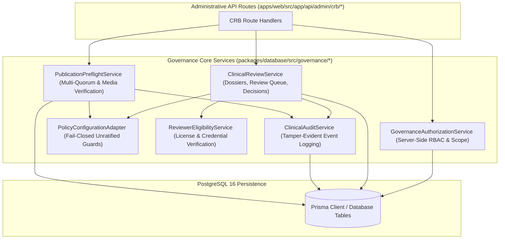

# DentalVis — Phase M6.1: Governance Service Layer & RBAC Foundations
## Implementation Planning and Readiness Assessment

**Architecture Baseline:** v1.9.1 — FROZEN  
**Parent Architecture:** `docs/architecture/M6_CLINICAL_REVIEW_BOARD_IMPLEMENTATION_PLAN.md`  
**Status:** Planning & Technical Security Audit Specification (Read-Only)  
**Effective Date:** November 24, 2026  
**Target Systems:** `packages/database`, `apps/web` (Administrative API Host), `apps/admin` (Client Boundary)  

---

## 1. Executive Summary

Phase M6.1 defines the first milestone of the DentalVis **Clinical Review Board (CRB)** technical roadmap. It establishes the server-only governance service layer, authentication integration architecture, server-side role-based authorization (RBAC), fail-closed policy configuration engine, and database-enforced audit security.

### Core Architectural Invariants Preserved
1. **Planning Only:** This document is an implementation plan and repository audit. No application source code, Prisma schemas, migrations, database records, reviewer accounts, or publication states are modified.
2. **Strict Server-Side Authorization:** Every protected governance operation enforces default-deny authorization on the server. Broad technical roles (e.g. `SYSTEM_ADMIN`) never grant unverified clinical authority.
3. **Fail-Closed Governance Invariants:** Unratified M5 policies (such as quorum counts, 90-day license verification validity, and reassessment intervals) have no active or synthetic defaults. If a policy is unratified, the system blocks review progression fail-closed.
4. **Physical Database Audit Immutability:** In Phase M6.1, `AdminAuditLog` will be elevated from an application-level convention to a physical database-enforced invariant via a dedicated PostgreSQL append-only trigger migration.
5. **Clear Hosting Separation:** `apps/web` hosts the authenticated administrative API (`/api/admin/crb/*`), consumed cross-origin by the standalone `apps/admin` Vite Single-Page Application (`SPA`).

---

## 2. Repository & Architecture Audit Findings

Every relevant repository component, data model, and testing suite was audited directly against the codebase:

### 2.1 Component Inventory & Status Classification

| Component / Layer | Source Location | Classification | Audit Verification Findings |
| :--- | :--- | :---: | :--- |
| **`User` Model** | `packages/database/prisma/schema.prisma` | `[EXISTING AND VERIFIED]` | Contains `id`, `role UserRole`, `licenseNumber String?`, `clinicalSpecialty String?`, `isActive Boolean`. Tested in `databaseProcedureRepository.test.ts`. |
| **`UserRole` Enum** | `packages/database/prisma/schema.prisma` | `[EXISTING AND VERIFIED]` | Exactly 5 values: `PATIENT_VIEWER`, `CLINICAL_AUTHOR`, `CLINICAL_REVIEWER`, `CHIEF_EDITOR`, `SYSTEM_ADMIN`. Reconciled against 7 CRB governance roles. |
| **`ProcedureRevision` Model** | `packages/database/prisma/schema.prisma` | `[EXISTING AND VERIFIED]` | Immutable snapshot model with `contentHash`, `snapshotData`, `authorId`. Bound to PostgreSQL trigger `trg_procedure_revision_immutable`. |
| **`ProcedureApproval` Model** | `packages/database/prisma/schema.prisma` | `[EXISTING AND VERIFIED]` | Clinical sign-off model with `reviewerId`, `licenseNumber`, `clinicalSpecialty`, `decision`, `isRevoked`. Bound to triggers `trg_procedure_approval_immutable` and `check_procedure_approval_governance()`. |
| **`ProcedureApprovalRevocation` Model**| `packages/database/prisma/schema.prisma` | `[EXISTING AND VERIFIED]` | Emergency takedown model with `approvalId`, `revokedByUserId`, `reason`. Bound to trigger `trg_procedure_approval_revocation_immutable`. |
| **`UserSession` Model** | `packages/database/prisma/schema.prisma` | `[EXISTING AND VERIFIED]` | Individual session instance model with `tokenHash`, `status`, `expiresAt`, `ipHash`. Passes cyclic succession tests in `domainInvariants.test.ts`. |
| **`SessionFamily` Model** | `packages/database/prisma/schema.prisma` | `[EXISTING AND VERIFIED]` | Session lifecycle group model with `userId`, `status`, `revokedAt`. Tested in `domainInvariants.test.ts`. |
| **`RevocationEvent` Model** | `packages/database/prisma/schema.prisma` | `[EXISTING AND VERIFIED]` | Distributed revocation event model bound to `ON DELETE RESTRICT` foreign keys. Tested in `domainInvariants.test.ts`. |
| **`RevocationConsumer` Model** | `packages/database/prisma/schema.prisma` | `[EXISTING AND VERIFIED]` | Consumer lease and cursor tracking model with `fencingGeneration`. Tested in `domainInvariants.test.ts`. |
| **`AdminAuditLog` Model** | `packages/database/prisma/schema.prisma` | `[EXISTING BUT REQUIRING EXTENSION]` | Model exists in schema and migration SQL (`CREATE TABLE "AdminAuditLog"`). **However, it lacks a database-level append-only trigger.** |
| **`DatabaseProcedureRepository`** | `packages/database/src/repository/` | `[EXISTING AND VERIFIED]` | Enforces publication filter (`currentStatus = 'PUBLISHED'` + unrevoked approval). Verified across 106 tests. |
| **Server-Only Provider Module** | `apps/web/src/server/procedureRepository.ts` | `[EXISTING AND VERIFIED]` | Enforces `import 'server-only'` boundary and fail-closed resolution. |
| **`apps/admin` Prototype** | `apps/admin/src/App.tsx` | `[EXISTING BUT REQUIRING EXTENSION]` | Standalone Vite SPA. Administrative auth and editorial features are currently disabled placeholders. |
| **Administrative API Routes** | `apps/web/src/app/api/admin/crb/*` | `[PROPOSED NEW COMPONENT]` | Does not exist; planned for M6.1 implementation. |
| **HTTP Authentication Middleware** | `apps/web/src/middleware.ts` | `[PROPOSED NEW COMPONENT]` | Does not exist; planned for M6.1 implementation. |
| **Governance Service Layer** | `packages/database/src/governance/*` | `[PROPOSED NEW COMPONENT]` | Does not exist; planned for M6.1 implementation. |

---

## 3. Governance Service Architecture

To avoid service bloat and ensure clear single-responsibility boundaries, the governance service layer in `packages/database/src/governance/` is partitioned into six cohesive, server-only services:



### Detailed Service Specifications

#### 1. `GovernanceAuthorizationService`
- **Responsibilities:** Evaluates incoming user sessions against the 7-role CRB permission matrix; enforces default-deny; prevents author self-approval; validates specialist clinical scope on Tier 3 content.
- **Inputs:** `actorUserId: string`, `requiredRole: CRBRole`, `targetRevisionId?: string`, `procedureTier?: GovernanceTier`, `procedureDiscipline?: string`.
- **Outputs:** `AuthorizationResult { authorized: boolean, actorRole: CRBRole, reason?: string }`.
- **Authorization Requirements:** Executes on every administrative API invocation; default-deny.
- **Failure Behavior:** Throws `UnauthorizedGovernanceActionError` (HTTP 403) with sanitized error message; logs unauthorized attempt to audit log.

#### 2. `PolicyConfigurationAdapter`
- **Responsibilities:** Provides centralized governance thresholds and rules. Strictly fails closed if a policy is unratified.
- **Inputs:** `tier: GovernanceTier`, `queryType: PolicyQueryType`.
- **Outputs:** Verified threshold numbers (e.g. required quorum).
- **Validation:** Asserts policy ratification status.
- **Failure Behavior:** Throws `UnconfiguredGovernancePolicyError` when unratified methods are invoked, immediately blocking review completion or assignment.

#### 3. `ReviewerEligibilityService`
- **Responsibilities:** Validates reviewer licensing currency; verifies specialty qualifications against statutory registers (OMFS, Periodontics, Dental Anesthesiology); verifies that COI declarations are signed.
- **Inputs:** `reviewerId: string`, `procedureTier: GovernanceTier`, `procedureCode: string`.
- **Outputs:** `EligibilityResult { isEligible: boolean, licenseVerifiedAt: Date, conflictsDeclared: boolean }`.
- **Failure Behavior:** Throws `IneligibleReviewerError` if license is expired, unsanctioned, or unverified within policy window.

#### 4. `ClinicalReviewService`
- **Responsibilities:** Orchestrates the clinical review lifecycle: generates dossiers, manages reviewer assignment queues, logs line-item comments, records final professional decisions (`APPROVED`, `REVISION_REQUIRED`, `REJECTED`), and handles emergency revocations.
- **Inputs:** Reviewer decision payloads, comments, revision IDs.
- **Outputs:** Immutable `ProcedureApproval` records or `ProcedureApprovalRevocation` records.
- **Validation:** Binds all decisions to exact RFC 8785 content hashes; rejects self-approvals (enforced at service and DB trigger layer).

#### 5. `ClinicalAuditService`
- **Responsibilities:** Emits tamper-evident administrative records to `AdminAuditLog` detailing actor identity, action type, target resource, request IP hash, and correlation tokens.
- **Inputs:** `actorId: string`, `action: string`, `targetType: string`, `targetId: string`, `metadata: Record<string, unknown>`, `ipHash?: string`.
- **Outputs:** `AdminAuditLog` persisted record.
- **Failure Behavior:** Audit logging is mandatory; if the audit write fails, the entire enclosing transaction rolls back.

#### 6. `PublicationPreflightService`
- **Responsibilities:** Executes automated publication validation prior to public release; verifies English `PUBLISHED` status, unrevoked approvals meeting tier quorum, Tamil translation sign-offs, and media asset reviews.
- **Inputs:** `procedureId: string`.
- **Outputs:** `PreflightResult { eligible: boolean, blockers: string[] }`.
- **Failure Behavior:** Halts publication pipeline and returns detailed blocker manifest to the Publication Administrator.

---

## 4. Role-Based Access Control: 7 CRB Roles to 5 Technical Roles

The M5 seven-role clinical governance model is reconciled against the five existing Prisma `UserRole` enum values through an explicit, server-enforced permission matrix:

```
  Existing Prisma UserRole Enum Values:
  [PATIENT_VIEWER] [CLINICAL_AUTHOR] [CLINICAL_REVIEWER] [CHIEF_EDITOR] [SYSTEM_ADMIN]
```

### 4.1 Reconciled Permission Matrix & Separation of Duties

| CRB Governance Role (M5) | Underlying Technical Role (`UserRole`) | Authorization Enforcement Mechanism | Permitted Operations | Strictly Prohibited Operations |
| :--- | :--- | :--- | :--- | :--- |
| **1. Content Author** | `CLINICAL_AUTHOR` | Direct Role Check + DB Trigger | Drafts procedures, creates revisions, resubmits after feedback. | **Cannot review, approve, or publish own content.** Blocked by trigger `check_procedure_approval_governance()`. |
| **2. Clinical Reviewer** | `CLINICAL_REVIEWER` | Role Check + Tier Scope Check | Reviews Tier 1 & 2 content; logs line-item comments; grants `APPROVED` / `REVISION_REQUIRED` / `REJECTED`. | Cannot evaluate Tier 3 content; cannot authorize public publication. |
| **3. Specialist Reviewer** | `CLINICAL_REVIEWER` | Role Check + `User.clinicalSpecialty` Verification | Evaluates Tier 3 surgical/sedation content; provides mandatory specialist sign-off. | Cannot approve procedures outside verified statutory specialty; cannot publish. |
| **4. CRB Chair (Chief Editor)** | `CHIEF_EDITOR` | Direct Role Check + Separation Scope Guard | Allocates review assignments; manages reviewer panels; resolves review deadlocks; executes emergency approval revocations. | **Cannot authorize public publication** (reserved for Publication Administrator); cannot override specialist dissent on Tier 3; cannot approve procedures authored by self. |
| **5. Governance Administrator** | `SYSTEM_ADMIN` | Role Check + Administrative Scope Boundary | Validates reviewer licenses; logs primary-source registry checks; monitors COI declarations. | **Strictly prohibited from evaluating clinical text or granting clinical approvals.** |
| **6. Publication Administrator** | `CHIEF_EDITOR` or `SYSTEM_ADMIN` | Dedicated Authorization Principal + Preflight Gate | Triggers public publication (`currentStatus = 'PUBLISHED'`) after automated preflight passes. | **Strictly prohibited from granting clinical approvals or overriding failed preflight checks.** Cannot be held simultaneously with Content Author or Reviewer for the same procedure. |
| **7. Independent Auditor** | `PATIENT_VIEWER` or `SYSTEM_ADMIN` | **Separately Scoped Identity (`COMPLIANCE_AUDITOR`)**; interim: read-only endpoint guard. | Read-only inspection across all dossiers, revisions, approvals, revocations, and audit logs. | **Strictly prohibited from clinical approval, publication, reviewer assignment, policy modification, credential modification, and audit-log mutation.** |

### 4.2 Separation of CRB Chair and Publication Administrator
Although both roles may be associated with the technical role `CHIEF_EDITOR`, they are strictly decoupled by server-side authorization:
1. **Scope Separation:**
   - **CRB Chair:** Authority over review assignment, clinical deadlocks, and emergency revocations. **Has NO authority to trigger public publication.**
   - **Publication Administrator:** Authority strictly limited to triggering the publication gate once all preflight checks pass. **Has NO clinical review or approval authority.**
2. **Prohibited Dual-Holdings:**
   - A clinician who authored or reviewed a procedure cannot act as the Publication Administrator for that procedure.
   - The Publication Administrator cannot execute publication without a 100% successful result from `PublicationPreflightService`.

### 4.3 Independent Auditor Authorization Correction
- **Rejection of Broad Role Mapping:** `PATIENT_VIEWER` is **never** used as an administrative audit identity; and `SYSTEM_ADMIN` does not grant audit access merely through an unrestricted broad role mapping.
- **Isolated Authorization Principal:** In Phase M6.1, an explicit `COMPLIANCE_AUDITOR` authorization scope is defined. A user must hold this dedicated scope to access audit logs and dossier histories.
- **Strict Read-Only Enforcement:** The API endpoints for auditing (`/api/admin/crb/audit/*`) strictly accept HTTP `GET` requests and enforce read-only execution at the database user level where possible.

---

## 5. Authentication, Session Security & Credential Architecture

### 5.1 Verified Session-Token Architecture in Prisma & SQL
A rigorous audit of the Prisma schema and applied migration SQL established the precise mechanism of session management:

1. **`UserSession.tokenHash` Purpose:**
   - `tokenHash` stores the SHA-256 hash of a cryptographically secure, high-entropy **Refresh Token** (64 characters hex). The raw refresh token is **never stored in the database**.
2. **Browser Credential Issuance:**
   - **Access Token:** Short-lived JWT (15-minute expiration) issued in an `HttpOnly`, `Secure`, `SameSite=Strict`, `Path=/` cookie (`__Host-dv-admin-at`).
   - **Refresh Token Cookie Standards (`__Host-` Standards Compliance):**
     - Per RFC 6265bis, the `__Host-` prefix strictly requires:
       1. `Secure = true`
       2. `Path = /` (The path MUST be `/`; sub-paths like `/api/admin/crb/auth` are invalid for `__Host-` prefix cookies).
       3. Must NOT have a `Domain` attribute.
     - The refresh cookie is named `__Host-dv-admin-rt` and is configured with `Path=/`, `HttpOnly=true`, `Secure=true`, `SameSite=Strict`.
     - *Alternative Path-Restricted Evaluation:* If restricting the cookie path strictly to `/api/admin/crb/auth` is required, the standard `__Secure-` prefix must be used instead (`__Secure-dv-admin-rt` with `Path=/api/admin/crb/auth`, `Secure=true`). However, using `__Host-dv-admin-rt` with `Path=/` provides superior protection against domain spoofing and is selected as the primary design.
3. **API Credential Validation Flow:**
   - Synchronous API requests present the short-lived access token. The API gateway verifies the cryptographic signature (e.g. Ed25519) and expiration without database queries.
   - Every 15 minutes (or when the access token expires), `apps/admin` calls `POST /api/admin/crb/auth/refresh`.
   - The server hashes the refresh token cookie and queries `UserSession` where `tokenHash = hash`.
4. **Token Rotation & Replay Detection:**
   - Refresh tokens follow **Option A: Idempotent Successor Bearer Rotation**.
   - Upon successful refresh, the old session transitions to `status = 'SUPERSEDED'`, a successor session is created (`successorSessionId`), and a new refresh token is issued.
   - If an old refresh token is reused after its successor has already been created (token replay attack), the server detects reuse via `predecessorSessionId`, marks the session `REVOKED_REPLAY_ATTACK`, and immediately revokes the entire `SessionFamily`.
5. **Session-Family Revocation:**
   - When a `SessionFamily` is revoked (`status = 'REVOKED'`), all existing child sessions are rendered invalid immediately upon their next access token refresh.
6. **Distributed Fencing (`RevocationConsumer` & `RevocationEvent`):**
   - In distributed deployments, synchronous API authorization validates revocation state against the primary database.
   - For cached authorization contexts, `RevocationConsumer` enforces a monotonic `fencingGeneration` BigInt cursor. If a worker's fencing generation is stale compared to the latest `RevocationEvent`, its cached authorization lease is rejected fail-closed.

---

## 6. Complete Cookie, CORS, and Synchronizer CSRF Token Security Design

Because `apps/admin` (Vite SPA) and `apps/web` (Next.js API Host) run on separate origins in development (and potentially across subdomains in production), security cannot rely on `SameSite=Strict` or CORS alone:

### 6.1 Cookie Configuration Standards
All administrative session cookies adhere strictly to standard security attributes:
- **`__Host-dv-admin-at` (Access Token):**
  - `Secure: true` (mandatory HTTPS, localhost exception for dev).
  - `HttpOnly: true` (blocks all JavaScript `document.cookie` access).
  - `SameSite: Strict` (blocks cross-site transmission).
  - `Path: /` (mandatory for `__Host-` prefix).
  - `Domain: [Omitted]` (mandatory; must not have a Domain attribute, preventing subdomain leaking).
- **`__Host-dv-admin-rt` (Refresh Token):**
  - `Secure: true`, `HttpOnly: true`, `SameSite: Strict`, `Path: /`, No `Domain`.

### 6.2 Credentialed CORS Allowlisting
- **No Wildcards:** `Access-Control-Allow-Origin: *` is strictly forbidden and rejected when credentials are enabled.
- **Explicit Origin Allowlist:**
  ```typescript
  const ALLOWED_ADMIN_ORIGINS = new Set([
    'http://localhost:3001', // Local Vite Admin SPA dev
    'https://admin.dentalvis.internal', // Production internal admin portal
  ]);
  ```
- **Response Headers on Allowed Origin Match:**
  - `Access-Control-Allow-Origin: <exact_request_origin>`
  - `Access-Control-Allow-Credentials: true`
  - `Access-Control-Allow-Methods: GET, POST, PUT, DELETE, OPTIONS`
  - `Access-Control-Allow-Headers: Content-Type, X-DentalVis-Admin-CSRF, X-CSRF-Token`
  - `Vary: Origin`

### 6.3 Complete Synchronizer CSRF Token Architecture (Multi-Layer Defense)
To provide complete protection against cross-site request forgery, the system integrates a cryptographically secure synchronizer token architecture alongside origin validation and custom header checks:

1. **Cryptographically Unpredictable Token Generation:**
   - CSRF tokens are generated using a cryptographically secure pseudorandom number generator (CSPRNG, `crypto.randomBytes(32).toString('hex')`, 256 bits of entropy).
2. **Session Binding:**
   - Every CSRF token is cryptographically bound to the active `UserSession.id`. The server stores an HMAC-SHA256 digest of the token keyed with a server secret and the session ID, preventing cross-user token substitution.
3. **Secure Issuance & Retrieval:**
   - Upon initial login and session refresh, the client calls `GET /api/admin/crb/auth/csrf-token`.
   - The server returns the CSRF token in a JSON response payload: `{ "csrfToken": "..." }`.
   - The token is held in-memory by the `apps/admin` Single-Page Application (never stored in `localStorage` to avoid XSS persistence).
4. **Submission Through Dedicated Header:**
   - Every mutating request (POST, PUT, DELETE) must submit the CSRF token via the HTTP request header:
     ```http
     X-CSRF-Token: <cryptographically_unpredictable_token>
     ```
   - In addition, the fixed custom header `X-DentalVis-Admin-CSRF: 1` is retained as an initial pre-flight check trigger.
5. **Server-Side Validation:**
   - The API gateway intercepts all mutating requests (POST, PUT, DELETE):
     - Validates that `Origin` / `Referer` strictly matches the allowed origins allowlist.
     - Confirms `X-DentalVis-Admin-CSRF === '1'`.
     - Validates `X-CSRF-Token` against the active session's expected CSRF token digest.
     - If the token is missing, expired, or does not match the session, the request is rejected immediately with HTTP 403 Forbidden (`CSRF_VERIFICATION_FAILED`).
6. **Token Lifecycle, Rotation & Invalidation:**
   - **Login:** Generates a new session and provisions a fresh CSRF token.
   - **Token Rotation:** Whenever the refresh token rotates (`POST /api/admin/crb/auth/refresh`), a fresh CSRF token is issued with the new access token.
   - **Logout:** Explicit logout (`POST /api/admin/crb/auth/logout`) revokes the `UserSession` and destroys the CSRF token.

---

## 7. Audit Security: Database Immutability & Privileged Access Limitations

### 7.1 Database-Enforced Immutability (`enforce_append_only`)
In Stage M6.1.1, the migration will attach the existing `enforce_append_only()` trigger to `AdminAuditLog`:

```sql
CREATE TRIGGER "trg_admin_audit_log_immutable"
    BEFORE UPDATE OR DELETE ON "AdminAuditLog"
    FOR EACH ROW EXECUTE FUNCTION enforce_append_only();
```

### 7.2 Accurate Qualification of Guarantees & Limitations
The trigger provides physical, database-enforced immutability against ordinary application traffic, but must be accurately qualified:
- **What is Prevented:** Any SQL `UPDATE` or `DELETE` issued by application connections, ORM queries, compromised administrative sessions, or SQL injection is physically rejected with an exception.
- **Privileged Access Limitations:**
  - PostgreSQL Superusers (`postgres`) can disable triggers (`ALTER TABLE "AdminAuditLog" DISABLE TRIGGER ALL;`).
  - Table owners or migration scripts executing DDL (`DROP TABLE`, `TRUNCATE`) can bypass triggers.
  - Physical database volume destruction or container deletion is not prevented by triggers.
- **Additional Compensating Controls Required:**
  1. *Least-Privilege Database Role:* The application's database user (`dentalvis_user`) is granted `INSERT` and `SELECT` only on `AdminAuditLog`; it is explicitly denied `TRUNCATE` and `ALTER TABLE`.
  2. *External Log Streaming:* In production, `AdminAuditLog` events are simultaneously streamed to an immutable, write-once-read-many (WORM) cloud logging sink (e.g. AWS CloudWatch with S3 Object Lock, or Google Cloud Audit Logs).

---

## 8. Staged Implementation Sequence & Negative-Test Strategy

Implementation is decomposed into five sequential, test-driven sub-milestones:

```
  [Stage M6.1.1: Audit Immutability Migration & Trigger Tests]
                     │
                     ▼
  [Stage M6.1.2: Fail-Closed Governance Policy Adapter]
                     │
                     ▼
  [Stage M6.1.3: Server-Side Authorization Service (RBAC & Scope)]
                     │
                     ▼
  [Stage M6.1.4: Governance Services Core (Review & Preflight)]
                     │
                     ▼
  [Stage M6.1.5: Administrative API Gateway, Auth, CORS & CSRF Middleware]
```

### Negative-Test Strategy Matrix

| Test Category | Target Layer | Scenario / Negative Input | Expected Rejection Behavior |
| :--- | :--- | :--- | :--- |
| **Auditor Escalation** | API / Service | `COMPLIANCE_AUDITOR` attempts `POST /api/admin/crb/reviews` | HTTP 403 Forbidden (`UNAUTHORIZED_GOVERNANCE_ACTION`) |
| **System Admin Clinical Approval** | API / Service | `SYSTEM_ADMIN` attempts `POST /api/admin/crb/approvals` | HTTP 403 Forbidden; administrative accounts cannot evaluate text |
| **Chair Unauthorized Publication** | API / Service | `CHIEF_EDITOR` (CRB Chair) attempts to trigger publication gate | HTTP 403 Forbidden; publication requires Publication Admin |
| **Publication Admin Review Attempt** | API / Service | Publication Administrator attempts to record clinical approval | HTTP 403 Forbidden; cannot act as clinician |
| **Author Self-Approval Guard** | Service & DB | Author of Revision attempts to approve own revision | PostgreSQL trigger exception (`CLINICAL_GOVERNANCE_VIOLATION`) |
| **Specialist Quorum Mismatch** | Service | General Dentist attempts sole review of Tier 3 Sinus Lift | Rejected: `SpecialistQuorumMismatchError` |
| **Replayed Refresh Token** | Auth Gateway | Refresh token reused after successor session already created | `REVOKED_REPLAY_ATTACK`; entire SessionFamily revoked |
| **Revoked Session Family Access** | Auth Gateway | Active access token presented after SessionFamily is revoked | HTTP 401 Unauthorized (`SESSION_REVOKED`) |
| **Stale Revocation Fencing Cursor**| Service | Worker presents stale fencing generation lease | Lease acquisition rejected; outbox transaction aborts |
| **Invalid CORS Origin** | API Gateway | Request from `http://malicious-site.com` | CORS headers omitted; pre-flight returns HTTP 403 |
| **Missing / Invalid CSRF Token** | API Gateway | Mutating POST request lacking valid `X-CSRF-Token` header | HTTP 403 Forbidden (`CSRF_VERIFICATION_FAILED`) |
| **Missing CSRF Custom Header** | API Gateway | Mutating POST request lacking `X-DentalVis-Admin-CSRF` | HTTP 403 Forbidden (`CSRF_HEADER_MISSING`) |
| **Invalid Origin / Referer** | API Gateway | Mutating POST request with spoofed `Origin` | HTTP 403 Forbidden (`ORIGIN_MISMATCH`) |
| **Audit Log UPDATE Rejection** | Database Engine| SQL `UPDATE "AdminAuditLog" SET action = 'tampered'` | PostgreSQL trigger exception (`DATABASE_INTEGRITY_VIOLATION`) |
| **Audit Log DELETE Rejection** | Database Engine| SQL `DELETE FROM "AdminAuditLog"` | PostgreSQL trigger exception (`DATABASE_INTEGRITY_VIOLATION`) |
| **Unratified Quorum Invocation** | Policy Adapter | Service queries quorum for Tier 3 before board vote | `UnconfiguredGovernancePolicyError`; review completion halted |

---

## 9. Final Phase M6.1 Recommendation

**Verdict: `M6.1 PLAN READY FOR IMPLEMENTATION`**

### Summary of Reconciled Security Architecture
1. **Independent Auditor:** Separated into a dedicated read-only authorization identity (`COMPLIANCE_AUDITOR`) without conflating `PATIENT_VIEWER` or `SYSTEM_ADMIN`.
2. **Chair vs Publication Admin:** Strictly decoupled so that CRB Chairs cannot publish and Publication Administrators cannot approve clinical content.
3. **Session Tokens:** Accurately detailed short-lived access tokens, hashed refresh tokens in `UserSession.tokenHash`, and Option A idempotent replay detection.
4. **Cookie & Synchronizer CSRF Tokens:** RFC 6265bis-compliant `__Host-` cookies (`Path=/`), explicit CORS origin allowlists, cryptographic in-memory CSRF synchronizer tokens, and origin/referer checks.
5. **Audit Immutability:** Accurately qualified as an append-only trigger protecting against ordinary traffic, combined with least-privilege DB roles.
